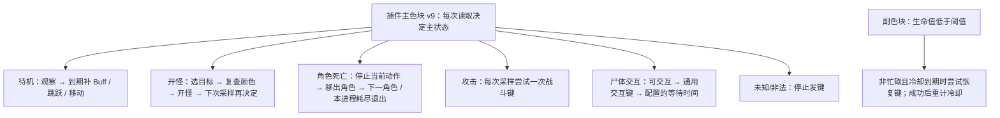

# wowAuto

通过插件色块检测状态的 Windows 图形化工具，支持为每个游戏进程选择自动钓鱼或自动战斗。钓鱼通过进程音频及声音特征匹配触发收竿，也保留定时模式；战斗根据主色块执行选目标、攻击和恢复。

角色表提供“职业”列，职业来自插件v6资料，旧记录显示未知；角色名、职业名和职业配置下拉统一采用对应职业色，选中项也保留颜色。更新插件后重载，正常下线保存，再刷新进程；职业不使用OCR。设置勾选框统一放大，表格内点击勾选单元格任意位置即可切换，战斗角色的钓鱼道具仍禁用；修改仍需保存。

主界面PID下不重复显示职业，钓鱼行显示“循环 N · 无咬钩超时 M”。超时统计未匹配时保护到期，以及匹配后的随机延迟使计划收竿严格超过本轮原始保护截止的次数（恰好相等不计），每轮至多一次；普通状态变化或其他异常不计，统计本身不增加成功循环数。计数按进程在本次工具运行中累计，停止、刷新和换角保留；新进程或重启工具从0开始。

当前生产版本采用每进程检测线程、专用操作线程、专用日志线程和子战网角色轮转。主线程只更新界面、协调轮转和传递消息，操作与日志文件写入分别由两个专用线程执行。使用说明见下方“子战网角色轮转与并行检测”，内部协议见 [PARALLEL_RUNTIME.md](PARALLEL_RUNTIME.md)。旧三槽位适配器仅用于兼容回归。

“重启脚本”右侧新增“结束倒计时”。点击后输入正整数秒并开始，按钮实时显示“倒计时：xx秒”；再次点击可重新设定或取消，关闭输入窗口保留原倒计时。倒计时期间任务继续，到期先停止全部任务，再重新枚举当前支持的时光服/无限服游戏进程（包括未刷新到列表的窗口），由操作线程发起正常退出。每个进程从实际发送关闭请求起等待30秒，仍未退出才核对原PID、启动时间、路径及客户端版本并强退一次，最多再等待5秒确认；异常按PID写入日志。所有退出请求处理结束后脚本保持运行，解除界面锁定并把按钮恢复为“结束倒计时”，可刷新进程或重新设置倒计时；无游戏进程或退出失败也会恢复界面。计时使用单调时钟，不保存到配置；重启脚本或手动关闭工具会取消本次倒计时。

## 文件

- `wowAuto.bat`：双击打开图形窗口，仅为本次 PowerShell 进程放行脚本执行策略。
- `wowAuto.ps1`：窗口、取色、前台状态检查及按键执行。
- `wowAuto.Engine.ps1`：钓鱼状态、截止时间及循环计数。
- `wowAuto.Capture.cs`、`wowAuto.Capture.ps1`：统一Windows.Graphics.Capture窗口捕获、最小化恢复请求和画面读取适配。
- `wowAuto.ActionQueue.ps1`：所有进程、钓鱼、战斗、刷新、角色切换及退出保护共用的优先级执行队列；每轮循环处理所有已到期且可执行事件，逐事件重查冷却 / 保持 / 优先级，等待前台稳定时保留窗口并继续处理独立后台事务。
- `wowAuto.Logging.ps1`、`wowAuto.Threading.cs`、`log/`：专用日志线程排队写入本次启动的合并事件日志与进程编排快照；保留消息来源 ThreadId，新增实际写入 WriterThreadId；运行日志不纳入 Git。
- `action-priorities.json`：集中配置事件优先级；完整清单和调度规则见 [ACTION_PRIORITIES.md](ACTION_PRIORITIES.md)。
- `wowAuto.Audio.cs`：Windows按进程实时监听、音量突变及FFT/包络特征匹配，启动时用系统.NET Framework编译。
- `wowAuto.Recordings.ps1`：编号录音目录、特征选择及设置窗口试听。
- `wowAuto.Unified.ps1`：统一进程页面、角色槽位任务选择、监控开启命令、混合任务调度和设置 Tab。
- `wowAuto.Accounts.ps1`：游戏目录设置、子战网目录读取、逐进程归属和角色列表过滤。
- `wowAuto.Rotation.ps1`、`wowAuto.Rotation.Native.cs`、`wowAuto.Rotation.Ocr.ps1`、`rotation.config.json`：旧三角色任务配置兼容与公共OCR几何、全局轮换、Windows中文OCR及三次点击选角。
- `autoFight.ps1`、`autoFight.Engine.ps1`、`autoFight.Native.cs`、`autoFight.config.json`：战斗界面适配、状态机、原生检测 / 输入及职业 / 通用配置。
- `audio-features/`：保存每次采集对应的数值特征；时光服录音1/2分别使用titan-01.feature/titan-02.feature，无限服录音1使用forerver.feature，目前均为试用特征。上述运行模块需放在同一目录，无额外音频驱动或外部DLL依赖。
- `audio-samples/`：本机保留的1秒匹配片段，用于试听；完整录音及原始归档也继续保留，此目录不上传Git。
- `config.ini`：钓鱼与文件日志可配置项，以 `key=value` 保存，和脚本放在同一目录并纳入 Git。

## 统一窗口捕获

所有白点、钓鱼主色 / 鱼饵点、战斗主色和OCR图片统一来自 `Windows.Graphics.Capture` 按游戏窗口句柄捕获的客户区画面，不使用桌面截图或PrintWindow后备。需要Windows 10 1903及以上且系统支持WGC；仍使用系统.NET Framework / Windows PowerShell 5.1，无额外SDK或外部DLL。每个进程身份及窗口句柄维护独立捕获会话，允许窗口在后台或被其他窗口覆盖。

每次读取先核对PID、启动时间、可执行路径及客户端版本。窗口最小化时清除旧帧，在公共动作队列提交 `Capture.Restore`（默认优先级45），使用 `ShowWindowAsync(SW_SHOWNOACTIVATE)` 尝试恢复；不调用SetForegroundWindow、不等待或保持前台。每500ms最多重试一次，从队列实际发起恢复算起最多5秒，排队等待不计入恢复期限；恢复后重新等待新帧。捕获初始化 / 尺寸更新的有效新帧等待也最多5秒，等待期间每100ms重试相关读取，不把等待当成插件关闭、白点消失或焦点失败。超过1500ms的帧、恢复前的帧、全黑画面及几何不匹配的帧不用于检测；WGC不支持或捕获失败会明确报错，不退回桌面画面。

WGC与Direct3D资源在各窗口的后台线程创建、取帧及关闭，UI线程只取已准备好的帧副本；空闲10秒释放捕获会话，后续请求重新建立。按DWM实际窗口画面边界和系统客户区物理原点裁剪客户区，排除标题栏 / 边框，并处理窗口尺寸变化。系统客户区宽高仍独立读取，用于OCR缓存的每轴5%容差比较，不从OCR结果推导。

钓鱼先后台读色，仅确定需要抛竿 / 收竿 / 道具 / 跳跃后将同一意图交给前台执行；战斗探测、刷新命令后的读样、角色OCR及登录白点等待都不要求前台。登出、监控开启聊天命令、选角点击及漏识别后的↑重试由公共队列取得前台后执行；普通输入激活等待200ms / 超时800ms，编排输入失败每500ms重试、连续5秒失败停止本行。安全松键及原有保持 / 冷却 / 钓鱼成功收竿跳跃规则保留。OCR截图不再停放鼠标；支持系统版本时捕获会话排除鼠标指针，旧版本沿用系统捕获行为。

`tests/WindowCapture.Adapters.Tests.ps1` 使用注入的合成窗口帧覆盖四类读取入口及等待传播；公共队列维护非激活恢复、后台读取和首帧等待的模拟用例。模拟用例不调用真实窗口捕获 / 恢复 / 按键。

## 使用

1. 在各游戏客户端启用对应版本的 wow_tools 插件，保持游戏窗口可用，并松开修饰键。刷新会自动开启所选监控，无需先手动输入插件命令。
2. 双击桌面的 `wowAuto` 快捷方式，或源码目录中的 `wowAuto.bat`。主界面只有“进程任务”一页；每行提供子战网绑定下拉框，在“设置 → 子战网”配置各角色的启用、钓鱼 / 战斗任务及钓鱼道具，不再单独选择进程模式。刷新按绑定账号的首个启用角色任务开启检测；未绑定账号时默认验证钓鱼，可直接开始当前角色。

   刷新先停止全部任务，依次切换对应游戏窗口到前台，等待约200ms，再通过聊天输入 `/wowdetector on` 或 `/fightdetector on`；发送成功后再等待约200ms并检测客户区中心色块。钓鱼须为红 / 绿，战斗须识别有效主色及职业。焦点或命令失败不会进行色块检测；未通过的行保持锁定。刷新结束尝试恢复原前台，仍须手动点击“开始”或“全部开始”，刷新本身不启动攻击或钓鱼。游戏聊天使用 Enter 打开 / 提交。

   “设置”窗口提供“自动钓鱼”“自动战斗”“游戏目录”“子战网”“检测与操作”五个 Tab；各页草稿独立，点击各页自己的保存按钮。保存后窗口保持打开，不会保存另一页的草稿；取消 / 关闭丢弃未保存的修改。子战网设置内使用“时光服 / 永恒服”两个子 Tab，分别选择本服子战网和配置角色。战斗设置内仍有时光服 / 无限服职业 Tab。
3. 每行显示窗口标题，PID后标注“时光服/无限服”和窗口位置，横向排列开始、停止和实时状态，下方选择绑定子战网并查看已启用角色与轮换进度，右侧实时状态框延伸至所属进程框底部并随高度调整。钓鱼道具开关按子战网角色保存，战斗角色禁用该选项，新槽位默认关闭。点击工具栏“设置”，分别填写时光服、无限服的“收杆延迟区间配置（ms）”，两个输入框按“下限 - 上限”排列；音频模式从匹配成功时开始，在闭区间内随机等待后收竿。取消音频勾选时仍从变绿开始使用同一范围计时。同一版本的全部进程共用范围，代码默认两服均为300–600ms，实际以保存的INI为准。启动值读取脚本目录的 `config.ini`，区间两个输入框的上下箭头每次100ms；接受1–3600000整数，最小值不得大于最大值；相等时固定等待。同一设置窗口提供“焦点重试间隔（ms，所有进程）”，支持1000–3600000整数，上下箭头每次1000ms，对两服全部进程生效。
4. 点击标签页内“全部开始”，将所有符合要求的行加入统一队列；“设置 → 自动钓鱼”中的“音频咬钩检测”从INI恢复，首次默认开启，仅停止钓鱼任务后可更改，点击“保存钓鱼设置”后生效；关闭该开关后使用原定时模式；也可以只点击单行“开始”。松开修饰键，工具会自动切换游戏窗口。每行状态框按最新在上的顺序显示最近50条日志，每条以 `[HH:mm:ss]` 显示状态更新时的本机时间戳，记录排队、下竿、收竿等待及异常；收竿等待时显示“当前随机延迟：N ms”，对应本轮实际登记的延迟；停止或刷新状态也显示时间戳。只有状态内容变化、进入新阶段或登记新的计时事件时刷新时间戳，单纯倒计时减少或界面定时刷新不会更新时间。
5. “全部停止”取消所有任务和定时事件；单行“停止”只取消对应任务。运行中可打开设置调整两服范围、焦点重试间隔、各服音频匹配门槛及四个全局快捷键。门槛为50–100%的整数、步长1%，代码默认86%，实际读取已保存的配置；达到门槛才触发，从下一次候选匹配开始生效，不清空当前音频会话、已采集的候选或待处理信号。等待设置用于下一次计时，已登记的钓鱼及焦点重试倒计时保持原截止时间。设置弹窗期间暂停自动切换与按键，保留队列，关闭后继续处理到期事件。关闭工具窗口会停止所有任务。更新后需关闭旧实例再打开新版。
6. 工具栏在“全部停止”后显示进程检测数量。“收竿后保持（ms，所有进程）”统一放在“设置”窗口，可输入0–60000，默认100，步长1ms；0表示不保持。点击保存后从下一次收竿生效，不会缩短已经开始的保持阶段；取消、关闭或保存失败不应用修改。保持时间保存到config.ini，下次打开自动读取。

工具栏的“重启脚本”会先停止全部任务、取消刷新和游戏退出保护、释放按键及音频 / 窗口捕获资源，然后关闭当前工具并重新打开源码中的wowAuto。新实例读取已保存配置，任务保持停止，需要手动开始；游戏客户端不退出。重启按钮防止连续点击重复启动，设置弹窗期间禁用。新实例按一次正常启动覆盖本次日志与计数；启动失败会提示从桌面快捷方式手动打开。

设置中的“日志保留条数”对所有进程的界面状态框生效，默认50、范围1–1000、步长1，保存到config.ini的StatusLogLimit。条数按状态变化或新计时事件记录计算，不按文本换行数计算。最新一条持续显示倒计时和音频指标，旧条目保留产生时的内容；单纯倒计时减少或界面定时刷新不会更新时间戳。相同进程行在停止、重新开始及刷新后保留界面历史，新进程独立记录。界面历史仅在内存，重启工具清空；文件日志按下面的大小上限另行保存。成功保存更小的条数后立即移除最旧界面记录；增大条数不恢复已移除的记录，取消或保存失败不改变历史。状态框可滚动查看，实时刷新保留当前滚动位置。

每次脚本启动都会覆盖 `log/wowAuto.log` 与 `log/info.log`。`wowAuto.log` 为 UTF-8 JSON Lines，记录状态变化与队列回调，包含 `Time`、`Pid`（无进程事件为 null）、`Kind`、`Message`；进程相关记录使用实际 PID。`info.log` 为一份 UTF-8 JSON 快照，只描述本次脚本启动时间、当前识别的进程数，以及各进程 PID、客户端、已配置子战网、子战网角色任务列表、当前运行角色和执行轮次。执行轮次从本次脚本启动起按每个进程成功启动钓鱼或战斗任务的次数计数，角色切换后再次启动会加一；停止任务只清空当前角色，不清零轮次。刷新进程、保存子战网设置及任务开始 / 停止时更新快照。两文件合计默认不超过50 MiB，可在 `config.ini` 用 `LogMaxSizeMB` 设置1–1024 MiB；到达上限时丢弃普通日志最早的完整 JSON 行，保留最近记录和完整 info 快照。日志目录不提交到远端。

普通“开始”需要绑定子战网并存在启用角色；“直接开始”需要本行监控验证通过。扫描 / 设置期间、进程退出或本行已经运行时禁用开始按钮。运行中的单行停止始终可以取消本行任务和待执行操作。

启动时窗口按内容和进程行数自动调整大小并居中，最大不超过屏幕可用区域；进程行过多时通过滚动条查看。

主界面及设置窗口采用炭灰背景和低饱和度灰蓝按钮，输入及状态框使用深灰，标签栏背景保持黑色，选中的进程任务标签使用低饱和度暗蓝色（RGB54/78/98）区分；所有界面文字统一白色，包括禁用按钮、复选框和设置错误提示。主窗口及设置窗口顶部的系统标题栏为黑底白字，保留原生拖动、窗口缩放及可用的最小化/最大化/关闭按钮；配色仅作用于本工具窗口。正文字体增至12pt，页脚11pt、标题23pt，进程行及状态框同步加高，设置窗口扩大以完整显示文字。游戏进程表头采用较浅灰色（RGB92/92/92），进程行采用深灰色（RGB72/72/72），便于区分。主工具栏不再显示快捷键录入行或音频检测开关，二者统一放在“设置”窗口。

## 匹配片段选择与试听

设置中的“咬钩匹配片段”分两服提供下拉菜单，序号在各版本内固定，不随列表位置或PID改变：

| 版本 | 序号 | 匹配片段 | 本机试听文件 | 匹配特征 |
| --- | --- | --- | --- | --- |
| 时光服 | 1 | 2026-10-11，右侧窗口，1秒 | audio-samples/titan-01-match.wav | audio-features/titan-01.feature |
| 时光服 | 2 | 2026-10-12，左上窗口，1秒 | audio-samples/titan-02-match.wav | audio-features/titan-02.feature |
| 无限服 | 1 | 2026-10-11，1秒 | audio-samples/forerver-01-match.wav | audio-features/forerver.feature |

默认时光服选择2、无限服选择1；已保存的INI优先。检测只使用所选片段编号对应的共同特征，不再自动合并两次时光服特征。旧titan.feature仍保留为历史合并版本，但不作为选择缺失时的回退。当前实际使用的序号显示在进程实时匹配状态中。

点击该版本的“试听”，播放所选1秒匹配片段一次；点击“停止试听”可中断。一次只播放一段，切换下拉选项、改听另一服、成功保存、取消、关闭设置或退出工具均停止并释放播放器。试听允许播放未保存的草稿，不会修改检测选择或INI；游戏操作在设置弹窗期间继续暂停。播放属于wowAuto自身进程，游戏的PID回环监听不包含它。

每个共同特征由该次采集中三段对齐后的1秒描述求平均生成。试听使用这三段素材中最接近共同特征的一段，直接调用生产匹配器的重采样和事件对齐逻辑截出11025个PCM16单声道样本（11025Hz，精确1秒），保留其80ms引入帧。时光服1号取原录音40.078–41.078秒（候选7），2号取127.689–128.689秒（候选6），无限服1号取124.197–125.197秒（候选22）。没有平均PCM波形或改变已验证的数值特征；匹配窗口原本就是1秒，本次修正选择和试听指向。

点击保存后，选择写入TitanAudioRecordingId/ForerverAudioRecordingId，沿用原序号和配置键。运行中的本轮声音候选、已匹配信号及保护/收竿截止时间保持；下一轮确认绿色时才切换特征并重新预热。道具保持结束后恢复同一钓鱼会话不会提前切换；停止后重新开始则直接使用已保存的选择。所选特征缺失/损坏时停止对应行，其他行继续，不退回另一片段或纯峰值。

三段180秒完整录音仍保留为audio-samples/titan-01.wav、titan-02.wav、forerver-01.wav；原始.local-backups归档不移动、不删除。设置只读取上表的短片段WAV。WAV继续由Git忽略，数值特征及选择配置纳入Git；换机器后，缺失试听WAV会在设置中显示提示，仍可使用已存在的匹配特征。wowAuto没有新增采集或导入功能。

自动钓鱼可配置项统一保存到脚本目录的 `config.ini`，重启自动读取：两服等待范围、各服无咬钩保护时间、焦点重试间隔、各服音频门槛及录音序号、日志保留条数、定期跳跃循环间隔、收竿后保持、四个快捷键、音频检测开关。各角色的道具开关保存在 `account-tasks.config.json`。设置窗口的选项点击保存后写入；音频检测开关随“保存钓鱼设置”原子保存。代码默认两服收竿等待300–600ms、无咬钩保护各35000ms、焦点重试30000ms、音频门槛86%、保持100ms、按键0/=/-、音频检测开启；启动时优先使用INI中的已保存值。恢复选项后仍需手动开始。原有截止时间及完整保持阶段不被配置保存重算。不再读写 `%LOCALAPPDATA%\wow_tools\wowAuto.settings.json`。

INI 支持下列配置键及可选的各进程勾选 / 模式记录。计时项用整数毫秒、门槛用整数百分比、开关用0/1；快捷键用文本，例如Ctrl+1、Shift+=、Alt+-，单键直接写0、=或-，组合键保留修饰键。可使用空行及以 `;` 或 `#` 开头的整行注释，不使用分节或行尾注释。键名不区分大小写；重复、未知键或非法值拒绝整份配置，不部分应用。兼容旧5项/7项/12项/14项/16项文件：日志保留条数缺失时沿用当前值（启动默认50），文件日志大小缺失时沿用当前值（启动默认50 MiB）；录音序号两项同时缺失时沿用当前选择（启动默认时光服2、无限服1）；新增两服无咬钩保护键同时缺失时沿用当前值（启动默认均为35000ms），两项音频门槛同时缺失时沿用当前门槛，新增保持/快捷键/音频开关五项同时缺失时沿用当前值；启动默认保持100ms、按键0/=/-、音频开启，未记录的进程勾选关闭、模式为钓鱼。上述分组仅缺部分键会报错。读取不重写旧文件，下一次保存会补全配置。

| 键 | 设置项 |
| --- | --- |
| `TitanMinimumMs` | 时光服收杆延迟区间下限 |
| `TitanMaximumMs` | 时光服收杆延迟区间上限 |
| `ForerverMinimumMs` | 无限服收杆延迟区间下限，保留仓库的forerver拼写 |
| `ForerverMaximumMs` | 无限服收杆延迟区间上限 |
| `FocusRetryIntervalMs` | 所有进程的焦点重试间隔 |
| `TitanAudioThresholdPercent` | 时光服音频门槛，50–100整数百分比 |
| `ForerverAudioThresholdPercent` | 无限服音频门槛，50–100整数百分比 |
| `TitanAudioTimeoutMs` | 时光服无咬钩保护，1000–3600000ms，默认35000 |
| `ForerverAudioTimeoutMs` | 无限服无咬钩保护，1000–3600000ms，默认35000 |
| `TitanAudioRecordingId` | 时光服录音序号：1或2，默认2 |
| `ForerverAudioRecordingId` | 无限服录音序号：当前为1 |
| `ReelHoldMs` | 所有进程收竿后保持，0–60000ms |
| `CastKey` | 抛竿按键，默认0 |
| `ReelKey` | 收竿按键，默认=，INI中写作ReelKey== |
| `ItemKey` | 钓鱼道具按键，默认- |
| `EquipRodKey` | 所有进程共用的装备鱼竿按键，无默认值；可省略或留空，须手动配置后开始编排或直接钓鱼 |
| `AudioDetectionEnabled` | 音频检测开关，0关闭、1开启 |
| `StatusLogLimit` | 每个进程保留的日志条数，1–1000整数，默认50 |
| `JumpEveryCycles` | 钓鱼成功收竿后的跳跃循环间隔，0关闭，默认0 |
| `LogMaxSizeMB` | `log/wowAuto.log` 与 `log/info.log` 合计大小上限，1–1024 MiB，默认50 |
| `UseItem_<PID>_<StartTicks>` | 旧版按进程保存的道具开关，0/1；仅用于旧编排缺少UseItem时只读迁移，日常使用角色任务配置 |
| `Mode_<PID>_<StartTicks>` | 旧版进程模式字段，只接受 fish / fight；保留读写兼容，当前任务由子战网角色任务决定 |

设置窗口保存时规范化重写全部配置，音频检测开关与钓鱼页一起保存；手动编辑后重新打开工具生效。所有字段统一验证，保存失败时不部分应用。`config.ini` 已纳入版本控制，设置保存会产生该文件的 Git 改动；提交、推送仍通过仓库维护流程执行，工具不会自动运行 Git。

“自动钓鱼 → 快捷键（所有进程）”新增“装备鱼竿”，手动录入单键或组合键，可用“清空”恢复未配置。编排中每次钓鱼角色登录，连续三次确认右下角登录白点后，先经操作线程按一次装备鱼竿键，收到成功回执才开启钓鱼监控、验证色块并开始任务；色块验证重试不会重复装备。“直接开始”钓鱼时同样先经操作线程发送一次装备键，成功回执后才启动音频监听、道具处理和抛竿；不登出或执行OCR。战斗任务跳过装备。未配置或发键失败会提示并停止本进程钓鱼任务，不退出游戏、不影响其他进程。装备动作沿用进程身份、前台和会话取消保护，但不依赖尚未开启的钓鱼色块；按键发送成功不代表脚本已核实游戏装备结果。旧INI缺少该字段按未配置读取，启动不重写；保存/取消/写入失败与其他钓鱼草稿保持一致。

窗口位置每秒更新，按窗口中心相对所在显示器的中线划分左上、右上、左下、右下；中心距离屏幕中点在宽高各10%以内时显示“居中”（含最大化/全屏窗口），最小化显示“最小化”，无法读取显示“位置未知”。跨屏窗口按主要所在显示器判断，支持负坐标显示器；位置更新只读，不切换窗口，也不改变状态时间戳。

“设置”窗口中的“快捷键（所有进程）”提供四个按键输入框：装备鱼竿无默认值，抛竿默认`0`，收竿默认`=`，钓鱼道具默认`-`（均为单键）。点击输入框后直接按下要绑定的键，可组合Ctrl、Shift、Alt与字母、数字、主键盘的`-`和`=`、F1–F24、小键盘或常用导航键；不接受单独的修饰键。编辑时保留当前分配，全部设置校验及保存成功后才应用新按键，下一次发送开始生效；取消、关闭设置或保存失败不应用按键草稿。重新打开设置显示当前有效分配。按键、保持时间和勾选统一持久保存到INI，重新打开工具恢复上次成功保存的值。

子战网设置中每个钓鱼角色有独立的“钓鱼道具”开关，默认关闭；保存子战网设置会停止该进程当前任务，重新开始及轮换时使用所选角色的开关。战斗角色不使用道具。停止 / 刷新保留子战网配置，同一PID和启动时间恢复配置；复用PID不继承旧计划。角色启用道具后，仅该角色启动的任务检查新版wowDetector的鱼饵检测小色块，位置为原中心检测点右侧32个屏幕像素：蓝色=鱼竿有有效临时附魔，紫色=附魔缺失或过期，灰色/其他颜色=未知。已有有效附魔直接继续钓鱼；缺失时在红色（未钓鱼）阶段发送道具键，已有绿色钓鱼状态时先完成本轮收竿再补用，避免中断引导。未知状态暂停该行抛竿并每秒重查，其他行继续；未勾选的进程不检查鱼饵点，不因鱼饵未知暂停，也不发送道具键。修改角色开关须保存子战网设置并重新开始；停止、刷新或关闭工具清除相关任务。需启用新版插件监测并装备鱼竿，道具按键采用设置窗口中的全局配置。

水下诱鱼器附加在鱼竿上，插件使用 `GetWeaponEnchantInfo` 检测临时附魔，不通过普通Buff列表。其他仍有效的临时鱼饵附魔也会跳过使用；鱼竿永久附魔不算鱼饵。道具判断在前台抛竿检测时进行，并在未钓鱼任务的检查事件中补充；钓鱼引导及收竿冷却期间不会为补饵主动中断流程。原固定10分钟补用和启动时无条件使用已替换为附魔检测。

道具键发送后等待鱼饵检测点确认临时附魔，成功确认后继续监测；以后附魔失效时可以再次补用。每次使用尝试从首次发键（包括发送失败）起最多等待5秒；期限内发送失败按500ms间隔重试，发键成功后不反复发送。到期仍未确认有效附魔时，关闭当前任务的道具检测并继续钓鱼，不改动角色道具开关。重新开始任务或切换到该角色的新任务会恢复检测。

插件2.1.1修正了窗口尺寸变化后的鱼饵点偏移：依据实际画面高度和UI缩放，将鱼饵点保持在中心右侧32个物理像素，大小为12×12物理像素，监测时每0.1秒更新。wowAuto每次取色读取当前客户区尺寸，无需为调整窗口大小手动修改坐标；拖动缩放过程中画面尚未稳定时仍可能暂时未知，稳定后重新检测。若游戏中鱼饵点为蓝/紫色但工具仍显示未知，可用 `/wowdetector status` 查看画面尺寸及定位信息；确认已重载新版插件、启动监测且面板可见。

道具操作加入统一前台调度：到期收竿优先，附魔检查/道具其次，普通抛竿/检测最后；均不能抢占收竿后保持时间。发送前核对进程身份、前台及两个检测点，黄色仍执行原背包规则。道具不增加有效钓鱼循环数，不重置现有钓鱼倒计时，成功发送道具键后固定等待3000ms，期间整个调度队列暂停抛竿、收竿和颜色检测，保持当前窗口；刷新扫描也等待结束，界面及停止按钮仍可响应。3秒结束后复查附魔；若尚未确认，则等至本次5秒期限，到期停用道具检测并继续钓鱼。发送失败在期限内每500ms重试，不新增3秒等待。取消勾选不会缩短已经开始的3秒等待；游戏内需将水下诱鱼器的使用动作绑定到配置的道具键。

刷新前停止所有行并取消等待，保留版本范围配置和仍存在进程的角色编排及角色道具设置，新增默认停止行，移除已退出进程。逐行扫描先等待约200ms，未识别时重试至800ms；扫描结束尝试切回原窗口。黄色、灰色、未知颜色、无法获得焦点或读取进程信息时不开放按钮。刷新只发送对应监控的开启命令，不执行任务按键，也不会因为黄色结束游戏。扫描后需手动重新开始通过检测的行。

使用PID与启动时间一起识别进程，避免新进程复用旧PID时继承旧任务。没有游戏进程时显示0行。

## 统一调度

工具使用一个共享时钟和事件队列，串行操作窗口：

### 音频模式（默认）

候选音量门槛按每个进程实际采集到的声音自适应：每轮前一秒学习声音强度和背景噪声，再结合背景波动计算门槛，无需设置音量比例；音量修改后下一轮重新学习。相似度门槛仍使用设置值，一秒抛竿屏蔽和模板校验保留。每次无咬钩保护到期会在全局日志中记录一条`audio-timeout`诊断，包含PID、本轮最高音量、已比较候选数、最高相似度、门槛及所用模板，便于区分前置音量过滤与模板未匹配。不会保存新的录音。

背景学习在声音超过当前基线1.5倍时暂停，候选触发门槛仍保留原来的3倍基线及噪声波动限制，防止逐渐变强的咬钩声被当作背景继续抬高门槛。2026-10-18经用户授权录制右上进程三开时的120秒音频，复现两轮有咬钩声但零候选的超时；原算法回放同样失败，修正后这两轮分别匹配96.35% / 96.59%，本段7个完整轮次各触发一次，历史450项分轮/初始/干扰回归通过。原始音频、音频包时间线及临时分析工具仅保留在本机忽略目录，不随工具持续录制；离线结果不代表游戏实际钓获率，相似度门槛和无咬钩保护时间沿用用户配置。

每个启动的进程有独立的Windows进程回环监听，按PID、启动时间、可执行文件路径核对身份。仅采集该进程及其子进程，不读取系统总音量；采集启动中暂不抛竿，初始化/运行失败停止对应行并显示原因，不自动退回定时收竿或系统混音。需要Windows Build 20348及以上（当前本机Windows 11满足条件）。依据[微软进程音频采集示例](https://learn.microsoft.com/en-us/samples/microsoft/windows-classic-samples/applicationloopbackaudio-sample/)，无需虚拟音频输出设备。

音频匹配达到设置阈值后，由音频线程直接通知对应检测线程，唤醒其消息等待；不再按50ms轮询咬钩标记。通知携带任务版本、钓鱼轮次和匹配时刻，收竿延迟从匹配时刻计算；停止、换角和重复的旧通知会忽略，正在等待操作回执时先排队再处理。设置中的“音频状态检查”周期只检查采集就绪和错误，匹配度文本仍约250ms更新。按用户安排本次未运行模拟或游戏测试，由用户实测。

确认绿色后，为本轮钓鱼登记音频会话及当前版本配置的无咬钩保护事件，此时不登记收竿时间。设置窗口的两服行分别提供“无咬钩保护（ms）”，默认35000、范围1000–3600000、步长1000；同一版本的进程共用该值。保存后用于下一轮确认绿色时的计时，不移动已经登记的保护或收竿截止时间；仅音频模式使用此项。后台独立监听，前1000ms建立基线并屏蔽抛竿尾音；随后按本轮实测参考音量、背景均值和波动自适应判断候选声音；最多保留8个重叠候选，每250ms至多新增一个，通过声音特征匹配后，从当前版本收杆延迟区间内随机取一个整数毫秒值，以匹配成功时刻加该值登记收竿事件。每轮只取一次，重复信号不重新计时；取消原无信号超时并停止本轮监听判断。本轮原始保护截止独立保存在AudioProtectionDeadline，不随后续设置变化或收竿倒计时改写；若匹配时刻加本次随机延迟严格晚于该截止，登记收竿时给本进程无咬钩超时加1，并写入带PID的audio-delay-timeout日志，重复通知不重复计数。该统计不取消或提前执行收竿，实际发键、失败及成功循环仍按原流程处理。状态框显示“收竿等待”和“当前随机延迟：N ms”，倒计时变化不更新时间戳或增加日志。延迟使用队列事件，等待期间可处理其他窗口；到期后优先收竿，不能抢占收竿后保持和道具3秒等待。道具等待期间暂停音频判断、清除未处理噪声并在等待后重新建立基线。保存新范围只用于之后的匹配，已登记收竿截止时间保持不变。状态框追加本进程音频峰值，数值变化不更新时间戳。

收竿前仍需切到对应窗口、确认身份及绿色。已变红则取消本轮收竿并重抛；灰/未知停止该行，黄色沿用背包规则。达到本轮登记的无咬钩保护时间仍未检测到信号，则重新进入抛竿及红转绿确认，不发送收竿键、不增加有效循环。成功下发音频触发的收竿才计数，并沿用冷却、强制抛竿和红转绿规则。停止/刷新/关闭工具释放监听；重启任务和复用PID不得使用旧监听或旧钓鱼会话信号。

音频模式使用预先校准的咬钩数值特征：通过音量门槛后，再匹配整体频谱、分段频谱及时间包络。缺少对应版本的特征，或文件无效时阻止该行启动并提示，不隐式退回纯音量突变；工具栏取消音频勾选仍使用原定时模式。同一进程中其他玩家播放完全相同的咬钩音效，仍可能匹配；过小的音效可能过不了音量门槛。插件关闭恢复游戏设置，wowAuto停止仅释放监听，不直接修改游戏CVar。

### 一次性音频校准

wowAuto不提供录制、导入或制样界面；设置可试听已保留的编号录音，也不把实时声音写入文件。运行时仅在内存中保留短暂音频帧以匹配预先生成的特征。

用户明确通知开始后，由维护者用独立的一次性工具采集所选PID的三分钟音频（180秒），并观察中心色块的状态变化。2026-10-11两服分别完成三分钟采集，不自动续录。独立工具保存44.1kHz PCM16单声道原录音及音频采样时间轴，便于后续检查细节；wowAuto运行时仍使用预先准备的特征。采集期间用户手动多轮钓鱼，wowAuto应停止，插件监控保持开启、可见，游戏保持在前台。采集工具不发送按键、不切换窗口。

从多轮钓鱼中的候选声音中，对齐起点并比较频谱及音量随时间的变化，排除抛竿、收竿后及偶发干扰，提取重复出现的共性特征；保留独立轮次做验证，不把同一片段的变换当成多轮实测。不同播放的原始波形会有相位及采样差异，因此使用对齐后的频谱与能量起伏作为共同波形特征，避免直接平均PCM导致抵消。原始长录音、分析结果及临时工具仅存本地忽略目录，不作为wowAuto运行文件或上传Git。尚未采集的版本不得用合成数据填充，也不得直接沿用另一服的特征。

每服的 `.feature` 文件包含格式号、采样率、窗口大小、推荐相似度门槛和1–8组特征变体。格式2使用11025Hz的一秒窗口（11025点）、24个整体对数频带（512点FFT）、8段×24频带的时序频谱及16段音量包络，共232个数值；三组各自归一化，按35%/50%/15%加权，不再只对整段频谱求平均。对齐允许约±23ms偏差，保留声音先后顺序；旧格式1不能直接使用，需从原始素材重新生成。同一版本的进程共用对应特征，启动时预加载，无模型、网络服务或额外依赖。实际门槛以设置及config.ini为准，特征文件中的Threshold仅为制样时的推荐值；降低门槛更容易命中，也更容易误匹配。特征和共享配置随代码管理，所有可配置项使用上面的固定键及进程勾选记录持久保存。

无限服当前使用2026-10-11的完整180秒录音：44.1kHz PCM16单声道、7938000样本，替换原40秒录音的单片段模板。用户确认主要等引导结束再抛竿，候选按连续钓鱼及抛竿声音定位；部分时段窗口在后台，状态标签不完整，因此仍为Status=trial，不能声称已确认钓获或准确率。六段主要重复候选中，使用第1.706、68.444、124.547秒的三段对齐特征求平均，分别归一化整体频谱、分段频谱与包络，生成一个共同特征；第44.100、97.419、179.193秒的三段不参与特征准备，仅用于验证。推荐门槛90%，实际门槛以config.ini中的已保存值为准，可在设置调整；旧版分数不能直接与新分数比较。两服使用各自采集的特征。

时光服另于2026-10-11采集右侧窗口的180秒录音（客户端3.80.2.70177、44.1kHz PCM16单声道、7938000样本），获得10轮完整钓鱼及1轮未结束区间，整个采集的色块状态均可读。10轮中各有一段重复声音：第9.029、24.385、40.029秒的三个起点对齐特征分组求平均、归一化，生成独立的titan.feature；另外7轮（58.697、76.416、98.476、114.310、132.589、147.076、166.581秒）不参与准备。生产匹配器按钓鱼区间离线回放，在86%及90%门槛下10轮各命中一次，最后未结束区间不触发；保留7轮分数约96.6%–98.8%，更换帧边界/大小最低96.57%。11个抛竿/初始区间、25个非钓鱼候选均未触发，后者单独比较的最高相似度80.57%。推荐门槛90%，实际门槛以config.ini中的已保存值为准；Status=trial，这是单次会话的候选验证，尚待实际钓获反馈。

2026-10-12又采集左上方时光服窗口的180秒音频（44.1kHz PCM16单声道、7938000样本），在原特征之外追加第二组共同特征。七个重复声音事件中，使用第2.415、98.476、128.059秒附近的三段对齐描述分组求平均并归一化，另外79.519、113.482、156.325、170.203秒的四段不参与制样。四段保留验证的匹配分数约95.81%–99.15%；86%与90%门槛下七段各触发一次，四段改变包边界/大小仍通过。原录音的十轮、十一个初始区间及二十五段非钓鱼候选也通过回归检查；另一个新声音约70.63%被这两个门槛拒绝。采集期间没有后台/未知色块记录，但其中一个绿色区间连续111秒，无法据此确认全部抛竿轮次；只能称为七个分离的声音候选，Status仍为trial。诊断时已保存的60%门槛会接受该不同声音，原特征也会；建议使用90%，实际配置仍保留用户设置。原始WAV及分析只保留本地，仅数值特征进入Git。

运行时先用音量突变筛选，保留200ms前置帧，再收集约一秒后续帧。对齐只寻找片段开头600ms内的首段强声音，保留80ms引入帧，避免被后续更响的声音带偏。若声音缓慢起伏、对齐后的尾部尚未收齐，保留当前候选并等待所需帧，总候选上限1.6秒（含200ms前置帧），不提前以零分拒绝、不用静音补尾；参考窗口不足仍拒绝。匹配失败后继续监听，短暂150ms防止持续噪声密集触发，不消耗本轮唯一信号。每次候选做三个小幅对齐比较，与少量变体取最高分；音频判断延迟约1–1.4秒，还需加上原窗口切换及队列等待。实时相似度及排除数不更新时间戳，会话切换/道具等待清空旧候选，停止/刷新/关闭释放监听。

无限服三分钟录音用生产匹配器离线回放，在86%及90%门槛下六段候选均各触发一次，分数93.05%/92.29%/95.47%/95.87%/97.20%/97.07%；其中第二、第四、第六段为保留验证片段。第二、第四段改变帧边界与帧大小后仍命中，最低91.45%。五个抛竿起始区间及一个其他声音区间未误触发；其他声音候选76.21%被拒绝。音量门槛及绿色状态/一秒预热仍是必要条件，不能只靠相似度排除所有噪声。这是一次录音中的独立片段验证，不是跨位置、跨会话的游戏成功率统计。

校准完成前不宣称具有真实咬钩识别能力；合成测试只验证算法与调度。采集后还应检查咬钩候选和干扰之间的相似度差距，样本不足或无法区分时保留待校准状态。

### 定时模式（取消音频勾选）

1. 选择一个待下竿窗口并切到前台，确认焦点后读取中心颜色。
2. 红色时按随机300–600ms周期重复抛竿键（相邻周期不同），留在当前窗口，直到变绿。
3. 绿色时按该进程所属版本的统一范围生成毫秒等待值，登记收竿事件，立即轮到下一个待下竿窗口；后台等待不会取消事件。
4. 每次调度先检查已到期收竿事件，按到期时间、登记顺序优先执行，能够中断当前下竿或窗口切换。切到事件对应的窗口并确认焦点后发送一次收竿键。
5. 收竿键释放后，在配置的保持时间内不主动切换到其他窗口；即使其他收竿事件已经到期，也必须等待保持结束。刷新扫描也遵守这段等待，界面按钮仍可响应。
6. 从收竿键释放后计时，经过1000ms和保持时间中的较大值，该行重新加入下竿队列。保持包含在这段冷却内；默认前100ms保持当前窗口，后900ms其他窗口可继续处理，不额外再等待1000ms。
7. 每次成功发送收竿键后，该行下一次检测到红色或绿色时，强制发送一次抛竿键。新一轮必须先检测到红色，再检测到绿色，才从确认绿色的时刻开始收竿倒计时；上一轮看到的红色不计入本轮。强制抛竿后若持续绿色，只按300–600ms周期检测，不重复强制抛竿、不倒计时；检测到红色后恢复重复抛竿键直到绿色。发送失败保留本次强制抛竿；黄色仍优先按背包规则处理，灰色/未知仍暂不按键。停止或重新开始任务清除本轮标记，首次启动行为不变。

灰色或未知颜色暂不按键，稍后重新排队。运行中无法切换窗口或获得前台焦点时，只暂停对应行并显示重试倒计时；原进程仍存在时，按设置中的焦点重试间隔（默认30000ms）重新核对进程身份并尝试恢复焦点，再次失败时按当前配置重新计时，其他行继续运行。保存新间隔不会移动已经登记的重试截止时间；下一次焦点失败使用新值。恢复焦点后继续原任务，保留尚未执行的收竿及道具计时，已到期收竿仍优先执行；重试也遵守收竿保持和道具3秒等待。检测或发送按键时失去焦点同样暂停重试。进程退出、身份变化或其他执行异常时停止对应行；单行停止、全部停止、刷新或关闭工具取消重试，重新开始不会继承旧重试。刷新扫描失败仍保持按钮锁定，需要重新刷新。窗口切换需等待画面稳定（约200ms）；实际发送时间还受Windows调度和切换耗时影响，不保证毫秒级实时性。

每次成功收竿后的冷却结束（至少1000ms，且遵守收竿保持和道具3秒等待）再检测颜色：首次有效颜色仍为绿色时，先发送一次不带修饰键的空格跳跃，再按原轮询周期继续强制抛竿及红转绿确认；红色则直接继续抛竿。每轮最多成功发送一次跳跃；未知颜色延后判断，黄色仍优先执行背包规则。首次启动或正常钓鱼等待中的绿色不会触发跳跃。

## 无限服等待时间调查（2026-10-11）

目前没有查到足以确认“成功率最高等待区间”的无限服咬钩时间分布或对照实测。无限服的[钓鱼法术数据](https://www.wowhead.com/forever/spell=7620/fishing)显示引导持续30秒；[无限服玩家的一手描述](https://us.forums.blizzard.com/en/wow/t/fishing-in-wow-forever/2371569)也报告每次抛竿最长30秒。这是引导上限，不是咬钩时刻，更不能据此认定18–25秒或其他区间最优。

无限服插件[EzFishing Forever作者说明](https://www.curseforge.com/wow/addons/ezfishing-forever)提供个人钓获统计及典型咬钩时间标记，同时明确没有直接的咬钩通知接口。wowDetector的绿色仅表示正在钓鱼引导，不能区分已咬钩；wowAuto从确认绿色起计时，还会受取色延迟、窗口切换和多进程排队影响。钓鱼技能与水域要求也影响跑鱼，不能将这些失败都归因于等待时间。

本次沿用原本保存的无限服18000–25000ms，不将其作为最优推荐。若要比较区间，应在相同版本、地点、装备和技能下进行人工对照，按实际成功取得战利品的次数/尝试次数比较，而非工具的“有效循环”计数。后者只代表成功下发收竿键。宽范围随机收竿也不会自动覆盖每次短暂咬钩时机；基于实际水花/音效及时响应，比仅凭引导状态猜测时刻更直接，现已提供按进程音量突变检测，仍需用无限服实际声音验证准确率。

## 颜色与操作

| 颜色 | 操作 |
| --- | --- |
| 红色 | 重复发送 抛竿键 直到变绿；到期收竿事件优先 |
| 绿色 | 音频模式登记本轮声音监听，定时模式登记随机毫秒收竿事件；转到下一个待下竿窗口 |
| 黄色 | 当前钓鱼角色普通背包已满；有角色编排时跳过该角色并立即切换下一可用角色，全部角色都被跳过才请求关闭该游戏进程。没有角色编排时停止本行并保留进程。有效收竿次数不参与判断，其他进程继续运行 |
| 灰色或无法识别 | 音频模式停止该行并释放监听；定时模式暂不操作 |

在钓鱼处理事件到期时通过窗口帧检查黄色，可在后台执行；保持现有轮询周期，不承诺后台持续取色。停止、刷新和关闭工具会移除对应待执行事件，重新开始不会继承旧计时。

插件黄色表示随身普通背包空格为0，不计银行、材料袋、专用袋，也不估算现有物品剩余堆叠容量。窗口遮挡不再改用遮挡窗口的像素；隐藏游戏UI、捕获失败或缺少有效新帧仍会影响检测。

## 定期跳跃

`进程任务 → 设置 → 自动钓鱼 → 跳跃间隔（循环，0关闭）` 保存到钓鱼INI的 `JumpEveryCycles`，支持0–1000000整数、步进1，默认0。每个进程单独累计成功完成的有效收竿循环；满N次后，在冷却 / 保持结束且检测到红或绿时，先按一次空格，再继续抛竿。未知数据延后，黄色优先，失败保留待跳重试。

原有“成功收竿后仍为绿色”的恢复跳跃继续保留；同一次跳跃满足两种原因，成功后重置该进程跳跃计数。跳跃必须由本次任务一次成功发送且已登记的收竿确认允许，正在钓鱼中不立即跳跃。停止 / 重新开始 / 刷新保留同一进程的计数，继承的待跳请求须等下一次成功收竿后的冷却与保持结束；收竿失败及无咬钩超时不赋予跳跃权限。成功跳跃或开始下一次抛竿后清除权限。新进程和工具重启从0开始。改变N时从新计数开始，相同值保存不重置；取消 / 校验 / 写入失败不应用草稿。此项与自动战斗公共间隔完全隔离。

## 收竿计数与退出

界面循环次数只按成功下发的已登记收竿动作累计，超时、失败或普通抛竿不计。停止 / 刷新保留计数；角色切换后清除该进程上一角色的循环与待跳计数。按循环配置的跳跃只能在本次成功收竿后的冷却与保持结束时执行；停止后继承的待跳请求，仍须等本次任务下一次成功收竿。

钓鱼包满或任一模式检测到角色死亡，只移出本进程本次子战网循环；所有启用角色都已移出才请求正常退出该进程，30秒仍存活时核对身份后强制结束。直接开始没有角色循环时只停止本行，不按收竿计数关闭进程。OCR累计30次一按↑一识别仍失败时也沿用此退出保护。单行停止、全部停止、刷新或关闭工具会取消尚未执行的退出 / 强制结束请求。

## 同步与兼容

从仓库根目录按“检查 → 提交 → 推送”顺序完成修改，再运行 `skills/wow-tools/scripts/sync-local.ps1`。完整维护流程见 [维护技能](../../skills/wow-tools/SKILL.md)。

同步脚本在 Windows 桌面创建 `wowAuto.lnk`，目标为源码目录的 `wowAuto.bat`，工作目录也是源码目录。确认快捷方式后，将桌面旧 `wowAuto.ps1`、`wowAuto.Engine.ps1`、`wowAuto.bat` 及 `wow-foreground-loop.bat`、`.ps1` 移入仓库 `.local-backups`，桌面只保留快捷方式。源码目录需保留完整的钓鱼、战斗及统一界面运行模块、audio-features目录及config.ini，试听还需保留本机audio-samples目录；移动仓库后重新执行同步以更新入口。插件同步至游戏的 `Interface\AddOns\wow_tools`。

插件已分成 `addon/titan/wow_tools`（时光服）与 `addon/forerver/wow_tools`（无限服）独立源码，同步默认分别安装到各自客户端。wowAuto已支持两服共用调度队列：时光服按 `_classic_titan_\WowClassic.exe` 与 `3.80.` 构建识别，无限服按 `_cn_beta_\Wow.exe` 与 `1.60.` 构建识别。游戏根目录可以在其他盘符，产品目录名需匹配；零售服同名Wow.exe、其他经典版及无法读取身份的进程不加入列表。刷新、发键、取色、焦点重试和退出保护均核对PID、启动时间及客户端路径/版本身份。

## 验证

`powershell.exe -NoProfile -ExecutionPolicy Bypass -File .\tests\ItemDetection.Tests.ps1` 验证附魔状态、已有Buff跳过、未知等待、绿色延后、收竿优先、3秒等待和附魔确认重试；`wowAuto.ps1 -UiTest` 同时执行 `ItemDetection.UiTests.ps1` 验证实际适配层的模拟按键。`ColorAdapter.Tests.ps1` 只编译生产C#并验证颜色分类，不调用窗口、取色或按键接口。

`powershell.exe -NoProfile -ExecutionPolicy Bypass -File .\tests\FocusRetry.Engine.Tests.ps1` 验证默认/自定义重试边界、运行中修改保留已登记截止时间、重复失败、事件保留、其他行调度、保持阶段和停止取消。`wowAuto.ps1 -UiTest` 还执行 `tests/FocusRetry.UiTests.ps1` 和 `tests/ClientSettings.UiTests.ps1`，模拟焦点失败及恢复、进程退出/身份变化、状态时间及倒计时、INI首次保存/覆盖/重读、注释、非法配置及文件锁定；使用独立临时INI并校验源码config.ini未被测试改变，不操作真实游戏。

`wowAuto.ps1 -UiTest` 中的 `tests/StatusTimestamp.UiTests.ps1` 使用模拟时钟验证时间戳只随状态更新，普通刷新、收竿/重试/道具/退出倒计时不会改变时间戳，新事件和状态变化会更新；不操作真实游戏。

`tests/StatusLog.UiTests.ps1` 随完整UiTest运行，验证区间标题及连接符、实际随机延迟与收竿事件一致、每进程日志隔离/上限/最新在上、旧记录及时间戳不变、滚动位置保留，以及设置重复保存/读取/取消/写入失败、非法或重复条数和旧16项INI兼容。使用临时INI及模拟进程、音频、焦点和按键，并核对源码config.ini未被修改。

`powershell.exe -NoProfile -ExecutionPolicy Bypass -File .\tests\GracefulExit.Tests.ps1` 使用模拟进程执行生产退出函数，验证正常关闭请求、30秒边界、提前退出、身份核对、失败处理、500次阈值和其他行隔离，不关闭真实游戏。

运行 `powershell.exe -NoProfile -ExecutionPolicy Bypass -File .\tests\Engine.Tests.ps1` 验证队列顺序、到期抢占、轮询、等待和取消，不发送按键或终止进程。`wowAuto.ps1 -PreviewPath <绝对PNG路径>` 渲染初始窗口。在源码目录加 `-UiTest` 执行 `tests/Layout.UiTests.ps1`、`tests/Refresh.UiTests.ps1` 和 `tests/Scheduler.UiTests.ps1`，用模拟进程验证布局、保持时间输入、刷新、全部开始/停止、调度和计时；不调用真实前台切换、取色、按键或结束进程接口。

`ClientIdentity.Tests.ps1`验证生产C#的客户端路径/版本识别、零售服排除、身份变化、四象限/居中及负坐标显示器，仅调用纯函数。`wowAuto.ps1 -UiTest`还执行`ClientSettings.UiTests.ps1`，模拟两服混合扫描/启动、统一设置保存/重载/取消/校验、已有计时保持、弹窗暂停、位置更新、无限服焦点重试及退出身份保护；配置写入独立临时文件并清理，不修改用户设置或操作真实游戏。

音频验证：Audio.Engine.Tests.ps1验证随机/固定的匹配后延迟、跨窗口调度、范围更新不重算已登记事件、会话隔离、去重、优先队列/保持、焦点暂停、超时重抛和计数；Audio.Detector.Tests.ps1验证合成PCM、基线、抛竿屏蔽和结构尺寸；UiTest追加Audio.UiTests.ps1并模拟每进程监听，覆盖两服延迟及运行中范围更新、等待状态及时间戳、到期前不按键、目标进程按键、停止释放与失败提示。Audio.Capture.Smoke.ps1仅采集不播放声音的测试PowerShell进程，验证本机Windows接口初始化及进程身份校验，不采集游戏音频、不发送按键。游戏中的实际咬钩准确率尚未实测。

特征匹配验证：Audio.Template.Tests.ps1使用合成音频验证音量归一化、相同频谱的声音换序、尾段缺失、短窗口拒绝、小幅对齐、迟到强峰的有界补帧等待、实时门槛修改、干扰后继续监听、预热/去重/重置，以及数值特征文件的保存/读取、变体及非法/旧格式输入。UiTest追加Audio.Features.UiTests.ps1，覆盖录制UI/API移除、两服特征隔离、缺失/无效特征阻止启动、模板分配及指标时间戳。Audio.Capture.Smoke.ps1仅监听自身无声PowerShell进程，不录音、不监听游戏。一次性用户授权的校准采集独立于这些验证。

`Audio.Timeout.UiTests.ps1`在完整UiTest中模拟两服不同的保护时间，验证独立计时、音频命中取消本行保护、当前截止不变/下轮生效、超时不发收竿或计数、定时模式隔离，以及设置/INI首次及重复保存、重新加载、取消、写入失败、非法/缺失/重复键和旧12项兼容。测试使用临时INI、模拟音频/焦点/按键，不修改用户配置或操作真实游戏。

`Audio.Recordings.UiTests.ps1`在UiTest中验证两服编号选择、试听路由/停止/取消/关闭/缺失文件、草稿及INI保存回滚/重开/旧14项兼容/非法配置，以及当前轮次与音频信号保留、下轮切换和版本隔离；所有播放、监听和输入均模拟。`Audio.RecordingSwitch.Tests.ps1`只初始化生产采集对象的内存字段，验证已开启会话禁止切换、参数校验、解除监听后更换匹配器、新声音匹配及已释放对象不再修改，不调用采集构造函数或启动音频线程。

## autoFight 自动战斗与剥皮

两服插件分别为 titan 2.1.36 / forerver 2.2.35。已有插件更新后执行 `/reload`，重启桌面 wowAuto 生效；首次增加角色存档声明的旧安装需要完全重启游戏客户端。两端使用 v9 双色块协议，不能混用旧版本。

右键小地图图标选择 `fight_detector` 会显示面板并自动启动，因此“启动”按钮随后置灰。关闭、隐藏面板、死亡、登出或重载停止检测，复活不自动恢复；命令为 `/fightdetector on|off|status`。插件面板已移除全部移动按钮及移动请求处理。

钓鱼 wowDetector 和战斗 fight_detector 在同一客户端中互斥：开启其中一个会自动停止并隐藏另一个，命令、面板启动按钮、小地图入口及菜单使用相同规则。隐藏但仍运行的钓鱼检测也会被关闭；切出钓鱼恢复其音频快照，切出战斗清理目标与恢复状态。只显示面板的 `show` 命令不启动检测、不切换当前模块；无法启动时保留原检测状态。

检测 / 开怪距离按职业保存，默认30码，可选5、10、15、20、25、30、35、40码。非战斗发现范围内可攻击怪物报opening，脚本执行选中和开怪；确认玩家进入战斗后直接报combat，脚本每秒尝试一次职业战斗键，不再检查目标匹配或近战距离。waiting状态及开始战斗距离设置已移除，原编号3作废。恢复副色块、恢复冷却和施法忙碌保护保留，死亡关闭检测；战斗标志不可读时暂停。

选中操作由脚本按键触发；插件只读取目标状态，不创建安全按钮、不接管游戏按键，也不设置游戏焦点。请将脚本公共选目标键绑定到游戏内的选取目标动作，并避免与其他自动战斗动作冲突。

选目标键仅位于脚本自动战斗设置的公共区域，全部服务器和职业共享，默认 Tab，支持 F10、Ctrl+Tab 等。插件面板不再提供这个设置；旧 SavedVariables 中的 TargetKey 字段被忽略。脚本设置保存失败或取消不会应用草稿。

每职业在插件面板设置一个恢复生命阈值，默认80%。生命值低于阈值时副色块为蓝色，达到阈值时为深灰色；生命值不可读时为灰色。战斗和非战斗使用同一阈值，不检测法力。脚本每职业只设置一个恢复键（默认F8）及冷却（默认30秒）；成功发送后进入冷却，冷却期间忽略副色块并继续依据主色块行动，失败不计冷却。冷却到期时若生命值仍低于阈值可再次恢复；忙碌时延后。冷却到期且生命值不可读时暂停发键。

脚本职业设置使用“时光服”和“无限服”两个 Tab，各自有独立职业下拉框和攻击 / 恢复按键。时光服保留10个职业，无限服保留9个职业；两服均没有武僧、恶魔猎手、唤魔师，无限服没有死亡骑士。切换 Tab 保留各页当前职业及未保存的按键草稿。通用设置在 Tab 下方，两服共享：

| 设置范围 | 内容 |
| --- | --- |
| 服务器 / 职业 | 开怪键、正常战斗键、恢复键及冷却秒数、补 Buff 键及间隔 / 次数 |
| 通用，全部服务器及职业共享 | 选中目标键、四向移动键、移动按住时长、拾取 / 剥皮交互键、交互等待时间、交互开关、公共最小按键间隔、自动跳跃间隔（秒） |

缺省开怪 F5、战斗 F6、恢复 F8 / 30秒冷却；通用移动 W/S/Q/E / 400ms，尸体交互 F7 / 3500ms，拾取与剥皮使用同一交互键和等待时间。实际使用已保存配置，当前用户自定义 A/D 和 `=` 已保留。脚本进程行已移除前 / 后 / 左 / 右手动移动按钮；移动按键配置保留，以兼容已有配置。移动键到期、状态变化、需要恢复、停止、刷新、打开设置、失焦或协议失效均及时释放。

插件仅在非战斗且软交互目标为死亡的 Creature、`UnitIsInteractable` 明确为真时报告同一个“尸体可交互”主色；不再调用 `CanLootUnit` 或解析可剥皮提示来区分拾取、剥皮。脚本读到该颜色就发送通用交互键，按配置的 `InteractionHoldMs` 等待后可再次尝试；即使色块暂时变为待机也不会缩短本次等待，进入战斗或副色块首次提示低生命 / 未知可提前结束。拾取窗口或剥皮施法期间主色保持交互，忙碌位阻止重复发键。脚本不记录尸体交互历史；游戏内须将通用交互键绑定原生交互。两服独立 Loot.lua 仅在任一检测开启时自动拾取，槽位锁定或接口失败保留人工处理；不修改 CVar。成功发键不代表已拾取或剥皮，须等待插件状态。

非战斗时，明确可交互的死亡 Creature 优先处理；尸体信息未知时仍检测附近活怪，活怪在检测距离内就报“开怪”，没有可用活怪才报“数据未知”。

自动拾取和拾取绑定确认由插件的实际检测开关控制：钓鱼 wowDetector 或战斗 fight_detector 任意一个开启，才订阅拾取事件并自动拾取、确认所有 `LOOT_BIND_CONFIRM` 槽位，不按物品品质、钓鱼 / 尸体 / 其他拾取来源筛选，无需桌面脚本运行。两个检测都关闭时不自动拾取且保留手动确认；仅显示面板但未开启检测不生效，钓鱼 hide 隐藏面板但检测仍开启时继续生效。关闭或死亡会取消待处理的拾取与确认；另一个检测继续开启则保持处理。确认推迟到下一帧、按槽位去重，成功才关闭对应拾取绑定提示，接口失败或受限时保留人工处理。

钓鱼和战斗检测关闭时各自取消业务事件订阅与0.1秒轮询；战斗检测始终不建立或清理按键绑定。右下角常驻白点仍独立显示，但位置校正改为每1秒一次，画面尺寸 / UI缩放事件仍即时校正。

钓鱼和战斗共用客户区中心定位锚点：主色块中心完全重合，两者副色块中心都在主色块右侧32个物理像素。两模块按各自状态使用颜色，切换时自动隐藏上一模块的色块。v9 战斗主色块为32×32物理像素，副色块为12×12：深灰无需恢复、蓝色需要恢复、灰色生命状态未知。脚本同帧读取主副两块，不校验心跳，也不要求颜色随时间变化。

主色块整体使用 v9 编码颜色，不再绘制中心2×2像素子区域；非战斗待机不再复用钓鱼的纯红色。恢复提示只在副色块，主色块颜色不随恢复需求变化。

主色块中心编码全部执行信息，颜色按状态变化，状态文字以插件面板为准：

| R | G | B |
| --- | --- | --- |
| 7+20×主状态 | 4×(身份+忙碌×26) | 4×(怪物编号+战斗×32) |

主状态0为不可执行的未知；1=待机、2=开怪、4=战斗、5=尸体交互、7=角色死亡。状态5同时用于拾取和剥皮，旧状态3、6颜色会被拒绝。身份为职业ID−1，无限服额外加13；怪物编号模32。脚本容忍每通道1个RGB值偏差，拒绝未知、非法字段 / 组合、服务器不符、该服不具备的职业和旧v6协议。

脚本不保存战斗主状态或遭遇子状态，每个运行中的战斗进程每秒读取一次色块，每次采样最多选择一个逻辑动作；发键前再读两块颜色，变化就取消旧动作，下一次采样由公共队列按新状态调度。脚本只记录恢复冷却截止时间、补 Buff 和跳跃计时。开怪的一次逻辑动作先选目标、复查主副色块，再按职业开怪键；战斗与尸体交互按每次色块采样尝试一次。交互等待期间先完成或释放本次等待，再处理后续动作。插件报死亡时停止当前任务并移出当前编排角色；报未知或非法颜色时暂停输入。

插件按 UIParent 实际高度与客户区物理高度换算尺寸；UI缩放、窗口及显示大小变化均重新定位。PC在同一 PMv2 DPI 上下文重新读取客户区中心，采样前后窗口尺寸 / 位置变化则丢弃。检测核对 PID、启动时间、路径、构建、服务器及职业，不要求前台。主色来自统一WGC客户区窗口帧，后台及遮挡使用同一捕获源，不借用桌面或其他窗口画面。运行时待机、死亡、冷却检测不切换前台；刷新会先切换前台发送监控开启命令，再检测色块。只有需要发键时切换窗口，取得焦点等待200ms，再重读主色及核对前台；保持交互可继续后台检测，移动失焦立即释放并继续监测。保持监测由公共25ms调度器处理，不再检测心跳冻结。插件在启动入口自动处理两个检测的互斥，桌面脚本按角色槽位确定任务，保存子战网设置停止本行；仅在任务类型改变时作废原检测验证，同类型的角色名、顺序、道具修改保留已有验证。

脚本进程行显示左上、右上、左下、右下、居中或最小化，与钓鱼模式使用相同的监视器位置判定，每秒更新。

`autoFight.config.json` v9顶层 Common 保存通用设置，Profiles 保存时光服10个、无限服9个职业的攻击、单一恢复键、恢复冷却和补 Buff。v1–v8只读迁移、不自动改文件，下次保存原子升级；旧版普通恢复键保留，紧急恢复键和正常战斗间隔不再使用。各职业恢复冷却默认30秒，设置范围1–3600秒；成功发送恢复键时开始计时，冷却期间忽略副色块的恢复提示，主色块仍照常采样和行动。移除该客户端不具备的职业配置，保留其余按键和公共参数。旧v1–v4配置自动跳跃默认关闭，旧v1–v5配置选目标键默认 Tab，旧v1–v6配置补 Buff 默认关闭。v1–v3迁移优先保留唯一非默认通用值，多个冲突自定义值须修正。取消、非法草稿和文件写入失败不应用任何字段。

每个职业可独立设置补 Buff 快捷键（默认 F11）、间隔（0–86400 秒，0 关闭）和每轮次数（1–20）。已配置的战斗角色登录后完成监控验证并启动任务时触发一轮，之后从上一轮最后一次成功按键起按间隔触发。轮内每次成功按键后至少等待 1 秒；发送失败不消耗次数。只在非战斗待机、非忙碌且没有移动请求时执行，到期但不安全时延后；所有按键仍走公共前台、白点、身份、色块复核和最小间隔。停止任务取消当前轮，角色切换后的新会话重新触发登录轮；打开设置保存相同值不重置当前轮。

公共最小间隔默认500ms，100–60000ms、步进100，约束所有战斗窗口和动作，包括恢复与跳跃；各进程每秒采样一次，交互键保持期间不重复发送。停止、刷新、保存不重置最后成功发键时间，松键不受公共间隔限制。与钓鱼音频及跳跃配置独立；所有模式、进程、角色切换、刷新及退出保护通过同一优先级执行队列下发操作；低生命恢复优先于正常战斗，正常战斗高于收竿。完整事件及可调优先级见 [ACTION_PRIORITIES.md](ACTION_PRIORITIES.md)。

全局“自动跳跃间隔”以秒设置，0关闭、1–3600秒、默认0。配置两服及所有职业共享，各活动进程从启动时独立计时；到期在待机或战斗且非忙碌时发送一次空格，战斗等待、移动和交互保持期间延后。跳跃仍受公共按键间隔及前台 / 身份 / 主色复查限制；成功后重新计时，失败保留待执行，不延迟下一次主色块采样。保存不同间隔从保存时重新计时，保存相同值保留截止时间；停止 / 刷新取消任务，重新开始重新计时。

暂时不可读时暂停发键、保留当前任务，最多连续重试800ms；持续失败停止并显示具体原因和主副RGB。按住移动键时不可读仍立即释放。最小化先经公共队列尝试非激活恢复，再等待窗口新帧；此等待不计入战斗色块800ms不可读期限。全黑帧及过期帧不会作为有效状态，不为检测强制取得前台。

验证使用 PowerShell解析、生产C#编译、Lua5.1及完整 `-UiTest` 模拟。FightDistance分别覆盖两服距离、双块几何、无心跳稳定颜色、非法主副色 / 职业 / 版本拒绝、怪物编号与物理坐标，并跨语言校验插件RGB。AutoFight.Recovery 验证统一生命阈值、单一恢复键、成功后冷却及冷却期间主状态继续运行；Engine / Jump / UI 模拟覆盖职业 Tab 草稿、配置迁移 / 失败、进程位置、定时跳跃边界 / 延后 / 失败 / 禁用 / 间隔、跨窗口门控和移动。验证不发送真实游戏按键、采集游戏音频或结束游戏。

`addon/tests/DetectorExclusion.Tests.lua` 在两服模拟环境分别加载真实钓鱼 / 战斗模块，验证命令 / 按钮 / 模块入口互斥、隐藏钓鱼切换、失败启动保留原模块、音频恢复、主副块共同坐标在窗口尺寸 / UI缩放变化后仍一致，以及战斗检测不触碰按键绑定。

`tests/Unified.UiTests.ps1` 随完整 `-UiTest` 验证单进程页 / 两设置 Tab、角色槽位任务恢复及旧字段兼容、先切换 / 开启命令再取色、失败不采样、混合任务手动启动、战斗高于收竿及保持约束、独立设置草稿及保存、旧 INI / 非法模式 / PID 复用隔离。所有游戏输入、焦点、取色及音频均模拟，核对用户 INI / JSON 未被修改。

## 子战网角色轮转与并行检测

每个魔兽进程有独立检测线程，钓鱼、战斗、死亡、白点和 OCR 都在该线程执行。需要按键、聊天命令或点击时，提交给唯一操作线程，暂停本进程检测，收到完成回执后继续；其他进程仍可独立检测。主 STA 界面线程只协调换角和消费消息，不执行游戏输入。

在“设置 → 子战网”的“时光服 / 永恒服”子 Tab 中选择本服子战网，逐个配置已识别角色是否启用、任务是钓鱼还是战斗，以及是否使用钓鱼道具。下拉框只显示子战网名称，两服的账号、角色和未保存草稿分别保留。在各进程行的下拉框中绑定子战网，该进程按配置顺序循环全部启用角色，不再配置三个槽位；只有一个角色也会登出重新登录。角色只来自插件有效下线记录，新角色默认停用，选角只识别第一页。同名但服务器不同的角色不能同时启用。

主线程按顶部的全局秒间隔通知所有参与进程换角。先完成全批登出请求，各检测线程再独立识别；全部角色位置准备完成后，操作线程逐个执行三连击；全部点击完成后，各线程确认登录及启用监控。整批完成前暂停普通任务输入。OCR 保留双锚点任一命中、同长度唯一 N−1 匹配、固定行中心、系统客户区尺寸每轴 5% 容差与 30 次 ↑ 后各识别一次的重试。三连击间隔提前随机生成，跨进程保留 1 秒安全阈值。等待选角 / 登录的停滞保护为 180 秒，仍在世界内每 30 秒重试登出。

“设置 → 检测与操作 → 检测周期”子页提供钓鱼 / 战斗色块、选角、登录、道具、死亡、音频状态检查、窗口位置、画面等待重试及 OCR 的全局检测周期，对两服所有进程生效，单位 ms。默认分别为 100 / 1000 / 300 / 300 / 300 / 1000 / 50 / 1000 / 100 / 1000，均可配置为 25–60000。周期与子战网任务分别保留草稿、分别原子保存，不保存另一页未提交的修改，也不会回退另一页已保存的配置；取消或保存失败不应用。周期保存并关闭设置窗口后用于后续检测。

“设置 → 检测与操作”内有“检测周期”和“操作队列”两个并列子 Tab。操作队列集中设置线程等待、回执检查、界面刷新、前台稳定与重试超时、按键时长、战斗公共间隔、收竿 / 道具 / 交互后等待，以及三连击间隔、跨进程保护和新帧重试，共22项。原钓鱼、战斗页对应输入已移走；原数值在首次读取时保留，不改写旧配置。两子页分别保存，关闭设置后应用，已经提交的操作继续使用提交时的完整快照。完整字段、默认与范围见 [PARALLEL_RUNTIME.md](PARALLEL_RUNTIME.md)。

配置保存在 `account-tasks.config.json` v1：按客户端和子战网隔离 Accounts，按 PID / 启动时间保存 Bindings，检测周期放在 Periods，操作队列时间放在可选 Operations。旧 `rotation.config.json` 保留全局轮转秒数与游戏目录；首次读取按账号合并旧角色任务，保留无冲突任务及道具设置，不自动改写旧文件。冲突或无法确定两服归属的旧角色任务停用，需在子战网页核对后保存。

进程行显示当前角色、剩余轮转时间与本次开始以来的成功切换次数。“直接开始”仍独立执行当前已登录角色，不登出、不运行 OCR、不参与定时轮转；没有确认角色名时不猜测。死亡或钓鱼包满只移出本进程本次循环，角色耗尽才正常退出该进程，30 秒未退出再强制结束。其他进程继续运行。

线程所有权、配置结构、日志新字段和验证命令见 [PARALLEL_RUNTIME.md](PARALLEL_RUNTIME.md)。

## 游戏目录、子战网与角色道具

在“设置 → 游戏目录”分别指定时光服和无限服目录，可以选择 `_classic_titan_` / `_cn_beta_`，也可以选择包含它们的总目录。保存时核对对应可执行文件和版本，全部验证、原子写入成功后才更新内存；取消或失败不应用草稿。目录保存在 `rotation.config.json` v2 的可选 `GameDirectories`（`titan` / `forerver`）字段；旧配置读取使用默认安装目录，不自动重写。

列表来自各服自己的 `WTF/Account/<子战网>/<服务器>/<角色>/SavedVariables/wow_tools.lua` 中的插件记录。子战网使用实际账号目录名，每个进程在主行下拉框选择归属，保存到 `account-tasks.config.json` 的 Bindings。角色任务在设置的子战网页配置，统一校验和原子保存。成功改变绑定才停止本行任务并作废监控验证，保存失败不影响原配置及任务。只有一个账号，或旧计划全部角色只属于一个账号时可自动建议；多个候选时须选择，不用文件时间戳猜测实时登录账号。进程安装目录与配置不一致时拒绝关联账号列表。

角色设置表只包含所选子战网有有效插件记录的角色；没有记录、记录损坏或名称 / 服务器不匹配时不显示，目录链接也排除。跨服务器相同名字在菜单中去重，全局历史不会混入。保存或启动编排前逐个核对记录，旧计划仍保留供核对。新角色登录后正常下线并刷新即可，无需开启钓鱼或战斗检测；“直接开始”也可用于首次运行已登录角色。工具只解析固定格式数据，不执行SavedVariables，也不读取登录凭据或改写游戏配置。选角仍以OCR定位固定行，等级、背包与专业技能信息来自插件API记录。

插件按角色保存 `wowToolsCharacterRecord`：插件加载及上线/背包/技能事件缓存所有角色本次有效等级、普通随身背包剩余空格与技能，首次进入世界即完整采集并更新记录和时间，正常下线时再完整重采、更新所有可读取字段。上线更新的是SavedVariables内存表，磁盘由客户端在下线或/reload时写入；插件不能强制在线落盘，脚本刷新读取最近磁盘快照。不管本次或以前是否开启过检测、有无旧记录，上线与正常下线都会更新记录；启动/关闭检测不控制角色记录，不增加轮询。下线阶段角色名或服务器接口已清空时，只回退本次上线已缓存的身份与数据；若可读身份冲突或本次从未取得有效身份，不猜测或借用旧磁盘身份。银行、材料及专用背包不计入；接口失败且本次无有效缓存时记为未知，真实0格表示包满；子战网表格显示“未知”而非空白。背包接口的可选包类型为空时按普通包统计，专用包仍排除，空格数缺失或受限不覆盖本次有效缓存。更新插件后先重载，再正常下线角色并刷新进程，才能替换旧快照。多个窗口分别写自己的角色文件，不共享覆盖账号级名单。强退不能保证产生新快照。进展通报会逐个列出轮换列表所有角色的剩余空格与下线快照时间，未知明确标出，跨服务器同名分别列出。

“设置 → 子战网”在每服子页显示上下两张角色表：满级角色在上，未满级角色在下并按等级从高到低排列，同级保留原顺序，等级未知排最后。满级按全局服务器上限判断，两服分别读取各自游戏API，不以固定80或60级推断。服务器上限未知时角色保留在下表并提示；该服务器任一角色保存全局上限后，刷新即可用于所有角色，无需逐个角色重录上限。两张表均可编辑启用、任务与道具；分组仅改变展示，保存时合并回原有轮转顺序，新增角色默认停用。

服务器等级上限保存在独立账号级全局变量 `wowToolsRealmLevels`，按服务器名称记录上限和采样时间，不写入角色文件或任务配置。脚本从各子战网的账号SavedVariables读取此表，在同一客户端目录内合并同名服务器的最新记录，两服互相隔离；同时间值冲突时标未知，不按角色级别或旧角色字段推断。只读解析白名单数据，不执行Lua。首次新增此全局保存项需完整退出并重开游戏，再登录该服务器任一角色、正常下线保存，刷新进程即可为该服务器所有角色共用。

“背包空格”后是“生产 / 采集技能”和“生活技能”两个只读列，每个技能显示“名称 当前/上限”，例如“剥皮 425/450”。生产和采集专业均记录，生活技能包括烹饪、钓鱼及客户端支持的考古，排除急救；没有学过显示“未学习”，旧记录或本次读取未知显示“未知”。多个技能分行显示，屏幕较窄时可横向滚动角色表。技能通过事件缓存，进入世界及正常下线都完整重采，退出阶段的未知/清空列表保留本次有效缓存，不增加后台轮询。

“设置 → 子战网 → 时光服 / 永恒服”角色表最后一列“炉石位置”显示炉石绑定的旅店/地点，由插件直接调用两服原生GetBindLocation读取，无需OCR或携带炉石物品。插件加载/进入世界及HEARTHSTONE_BOUND事件更新本次缓存；下线仍重新探测，可读时取最新地点，已清空或接口失败时保留本次有效值。新角色记录为v5九字段平表（含bindLocation，不含maxLevel）；v1-v4仍能读取，v4中的旧角色上限不参与分组，旧记录及未知地点显示“未知”，不影响角色任务配置。更新后重启脚本，游戏/reload，正常下线保存，再刷新进程即可看到地点；这不是在线实时位置。

点击“刷新进程”也会刷新各进程的子战网和角色记录；主界面不再显示“角色已刷新”提示，打开设置的子战网页即可查看角色名单。新下线保存的角色、更新的等级 / 背包信息和失效记录都会重新读取；之后打开子战网设置即可使用最新角色名单。角色刷新不要求色块验证通过，也不会自动启用新角色。

每个子战网角色独立保存 UseItem；战斗角色禁用钓鱼道具。全局钓鱼道具按键与成功收竿循环跳跃规则保留。新架构主验证命令为 `powershell -NoProfile -ExecutionPolicy Bypass -File tools/wowAuto/tests/Run.ParallelUi.Tests.ps1`，全部游戏操作使用替代接口。

死亡检测发生在死亡后、等待释放灵魂阶段。灵魂状态不会新触发角色移除，也不执行释放灵魂或跑尸操作；已经在死亡阶段记录的信号会保留供脚本读取。
