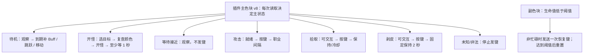

# wowAuto

通过插件色块检测状态的 Windows 图形化工具，支持为每个游戏进程选择自动钓鱼或自动战斗。钓鱼通过进程音频及声音特征匹配触发收竿，也保留定时模式；战斗根据主色块执行选目标、攻击和恢复。

## 文件

- `wowAuto.bat`：双击打开图形窗口，仅为本次 PowerShell 进程放行脚本执行策略。
- `wowAuto.ps1`：窗口、取色、前台状态检查及按键执行。
- `wowAuto.Engine.ps1`：钓鱼状态、截止时间及循环计数。
- `wowAuto.Capture.cs`、`wowAuto.Capture.ps1`：统一Windows.Graphics.Capture窗口捕获、最小化恢复请求和画面读取适配。
- `wowAuto.ActionQueue.ps1`：所有进程、钓鱼、战斗、刷新、角色切换及退出保护共用的优先级执行队列；每轮循环处理所有已到期且可执行事件，逐事件重查冷却 / 保持 / 优先级，等待前台稳定时保留窗口并继续处理独立后台事务。
- `action-priorities.json`：集中配置事件优先级；完整清单和调度规则见 [ACTION_PRIORITIES.md](ACTION_PRIORITIES.md)。
- `wowAuto.Audio.cs`：Windows按进程实时监听、音量突变及FFT/包络特征匹配，启动时用系统.NET Framework编译。
- `wowAuto.Recordings.ps1`：编号录音目录、特征选择及设置窗口试听。
- `wowAuto.Unified.ps1`：统一进程页面、角色槽位任务选择、监控开启命令、混合任务调度和设置 Tab。
- `wowAuto.Accounts.ps1`：游戏目录设置、子战网目录读取、逐进程归属和角色列表过滤。
- `wowAuto.Rotation.ps1`、`wowAuto.Rotation.Native.cs`、`wowAuto.Rotation.Ocr.ps1`、`rotation.config.json`：三槽位角色名称编排、全局轮换、Windows中文OCR及三次点击选角。
- `autoFight.ps1`、`autoFight.Engine.ps1`、`autoFight.Native.cs`、`autoFight.config.json`：战斗界面适配、状态机、原生检测 / 输入及职业 / 通用配置。
- `audio-features/`：保存每次采集对应的数值特征；时光服录音1/2分别使用titan-01.feature/titan-02.feature，无限服录音1使用forerver.feature，目前均为试用特征。上述运行模块需放在同一目录，无额外音频驱动或外部DLL依赖。
- `audio-samples/`：本机保留的1秒匹配片段，用于试听；完整录音及原始归档也继续保留，此目录不上传Git。
- `config.ini`：自动钓鱼可配置项，以 `key=value` 保存，和脚本放在同一目录并纳入 Git。

## 统一窗口捕获

所有白点、钓鱼主色 / 鱼饵点、战斗主色和OCR图片统一来自 `Windows.Graphics.Capture` 按游戏窗口句柄捕获的客户区画面，不使用桌面截图或PrintWindow后备。需要Windows 10 1903及以上且系统支持WGC；仍使用系统.NET Framework / Windows PowerShell 5.1，无额外SDK或外部DLL。每个进程身份及窗口句柄维护独立捕获会话，允许窗口在后台或被其他窗口覆盖。

每次读取先核对PID、启动时间、可执行路径及客户端版本。窗口最小化时清除旧帧，在公共动作队列提交 `Capture.Restore`（默认优先级45），使用 `ShowWindowAsync(SW_SHOWNOACTIVATE)` 尝试恢复；不调用SetForegroundWindow、不等待或保持前台。每500ms最多重试一次，从队列实际发起恢复算起最多5秒，排队等待不计入恢复期限；恢复后重新等待新帧。捕获初始化 / 尺寸更新的有效新帧等待也最多5秒，等待期间每100ms重试相关读取，不把等待当成插件关闭、白点消失或焦点失败。超过1500ms的帧、恢复前的帧、全黑画面及几何不匹配的帧不用于检测；WGC不支持或捕获失败会明确报错，不退回桌面画面。

WGC与Direct3D资源在各窗口的后台线程创建、取帧及关闭，UI线程只取已准备好的帧副本；空闲10秒释放捕获会话，后续请求重新建立。按DWM实际窗口画面边界和系统客户区物理原点裁剪客户区，排除标题栏 / 边框，并处理窗口尺寸变化。系统客户区宽高仍独立读取，用于OCR缓存的每轴5%容差比较，不从OCR结果推导。

钓鱼先后台读色，仅确定需要抛竿 / 收竿 / 道具 / 跳跃后将同一意图交给前台执行；战斗探测、刷新命令后的读样、角色OCR及登录白点等待都不要求前台。登出、监控开启聊天命令和选角点击仍由公共队列取得前台后执行；普通输入激活等待200ms / 超时800ms，编排输入失败每500ms重试、连续5秒失败停止本行。安全松键及原有保持 / 冷却 / 钓鱼成功收竿跳跃规则保留。OCR截图不再停放鼠标；支持系统版本时捕获会话排除鼠标指针，旧版本沿用系统捕获行为。

本次在Mac按用户要求仅开发并提交推送，未执行解析、编译、测试、UI或游戏验证，也未同步Windows。`tests/WindowCapture.Adapters.Tests.ps1` 使用注入的合成窗口帧覆盖四类读取入口及等待传播；公共队列维护非激活恢复、后台读取和首帧等待的模拟用例。模拟用例不调用真实窗口捕获 / 恢复 / 按键。

## 使用

1. 在各游戏客户端启用对应版本的 wow_tools 插件，保持游戏窗口可用，并松开修饰键。刷新会自动开启所选监控，无需先手动输入插件命令。
2. 双击桌面的 `wowAuto` 快捷方式，或源码目录中的 `wowAuto.bat`。主界面只有“进程任务”一页；每行提供“角色编排”和“子战网”选择，在三个槽位内选择名称、钓鱼 / 战斗任务及是否使用钓鱼道具，不再单独选择进程模式。刷新按首个有效槽位开启检测，轮换按当前槽位执行；未设置槽位时默认钓鱼。

   刷新先停止全部任务，依次切换对应游戏窗口到前台，等待约200ms，再通过聊天输入 `/wowdetector on` 或 `/fightdetector on`；发送成功后再等待约200ms并检测客户区中心色块。钓鱼须为红 / 绿，战斗须识别有效主色及职业。焦点或命令失败不会进行色块检测；未通过的行保持锁定。刷新结束尝试恢复原前台，仍须手动点击“开始”或“全部开始”，刷新本身不启动攻击或钓鱼。游戏聊天使用 Enter 打开 / 提交。

   “设置”窗口提供“自动钓鱼”“自动战斗”“游戏目录”三个 Tab；各页草稿独立，分别点击“保存钓鱼设置”或“保存战斗设置”。保存后窗口保持打开，不会保存另一页的草稿；取消 / 关闭丢弃未保存的修改。战斗设置内仍有时光服 / 无限服职业 Tab。
3. 每行显示窗口标题，PID后标注“时光服/无限服”和窗口位置，横向排列开始、停止和实时状态，下方选择子战网并编辑角色编排。钓鱼道具开关按槽位保存，战斗槽位禁用该选项，新槽位默认关闭。点击工具栏“设置”，分别填写时光服、无限服的“收杆延迟区间配置（ms）”，两个输入框按“下限 - 上限”排列；音频模式从匹配成功时开始，在闭区间内随机等待后收竿。取消音频勾选时仍从变绿开始使用同一范围计时。同一版本的全部进程共用范围，代码默认两服均为300–600ms，实际以保存的INI为准。启动值读取脚本目录的 `config.ini`，区间两个输入框的上下箭头每次100ms；接受1–3600000整数，最小值不得大于最大值；相等时固定等待。同一设置窗口提供“焦点重试间隔（ms，所有进程）”，支持1000–3600000整数，上下箭头每次1000ms，对两服全部进程生效。
4. 点击标签页内“全部开始”，将所有符合要求的行加入统一队列；工具栏“音频咬钩检测”从INI恢复，首次默认开启，仅停止全部任务后可更改，取消后使用原定时模式；也可以只点击单行“开始”。松开修饰键，工具会自动切换游戏窗口。每行状态框按最新在上的顺序显示最近50条日志，每条以 `[HH:mm:ss]` 显示状态更新时的本机时间戳，记录排队、下竿、收竿等待及异常；收竿等待时显示“当前随机延迟：N ms”，对应本轮实际登记的延迟；停止或刷新状态也显示时间戳。只有状态内容变化、进入新阶段或登记新的计时事件时刷新时间戳，单纯倒计时减少或界面定时刷新不会更新时间。
5. “全部停止”取消所有任务和定时事件；单行“停止”只取消对应任务。运行中可打开设置调整两服范围、焦点重试间隔、各服音频匹配门槛及三个全局快捷键。门槛为50–100%的整数、步长1%，代码默认86%，实际读取已保存的配置；达到门槛才触发，从下一次候选匹配开始生效，不清空当前音频会话、已采集的候选或待处理信号。等待设置用于下一次计时，已登记的钓鱼及焦点重试倒计时保持原截止时间。设置弹窗期间暂停自动切换与按键，保留队列，关闭后继续处理到期事件。关闭工具窗口会停止所有任务。更新后需关闭旧实例再打开新版。
6. 工具栏在“全部停止”后显示进程检测数量。“收竿后保持（ms，所有进程）”统一放在“设置”窗口，可输入0–60000，默认100，步长1ms；0表示不保持。点击保存后从下一次收竿生效，不会缩短已经开始的保持阶段；取消、关闭或保存失败不应用修改。保持时间保存到config.ini，下次打开自动读取。

设置中的“日志保留条数”对所有进程生效，默认50、范围1–1000、步长1，保存到config.ini的StatusLogLimit。条数按状态变化或新计时事件记录计算，不按文本换行数计算。最新一条持续显示倒计时和音频指标，旧条目保留产生时的内容；单纯轮询或数值刷新不增加日志，也不刷新时间戳。相同进程行在停止、重新开始及刷新后保留历史，新进程独立记录。日志仅保存在内存，重启工具清空历史，配置条数仍恢复。成功保存更小的条数后立即移除最旧记录；增大条数不恢复已移除的记录，取消或保存失败不改变历史。状态框可滚动查看，实时刷新保留当前滚动位置。

单行“开始”在未通过刷新验证、模式切换后尚未重新验证、对应配置无效、扫描 / 设置期间或本行任务 / 角色编排运行中禁用。战斗后台监测、后台刷新及交互保持不读取要求前台的登录白点；只在需要发键、取得前台并等待画面刷新后复核白点，后台状态本身不会使CanStart失效。运行中的单行“停止”始终保留，即使启动条件已失效也可取消任务。

启动时窗口按内容和进程行数自动调整大小并居中，最大不超过屏幕可用区域；进程行过多时通过滚动条查看。

主界面及设置窗口采用炭灰背景和低饱和度灰蓝按钮，输入及状态框使用深灰，标签栏背景保持黑色，选中的进程任务标签使用低饱和度暗蓝色（RGB54/78/98）区分；所有界面文字统一白色，包括禁用按钮、复选框和设置错误提示。主窗口及设置窗口顶部的系统标题栏为黑底白字，保留原生拖动、窗口缩放及可用的最小化/最大化/关闭按钮；配色仅作用于本工具窗口。正文字体增至12pt，页脚11pt、标题23pt，进程行及状态框同步加高，设置窗口扩大以完整显示文字。主工具栏不再显示快捷键录入行，快捷键统一放在“设置”窗口。

## 匹配片段选择与试听

设置中的“咬钩匹配片段”分两服提供下拉菜单，序号在各版本内固定，不随列表位置或PID改变：

| 版本 | 序号 | 匹配片段 | 本机试听文件 | 匹配特征 |
| --- | --- | --- | --- | --- |
| 时光服 | 1 | 2026-10-11，右侧窗口，1秒 | audio-samples/titan-01-match.wav | audio-features/titan-01.feature |
| 时光服 | 2 | 2026-10-12，左上窗口，1秒 | audio-samples/titan-02-match.wav | audio-features/titan-02.feature |
| 无限服 | 1 | 2026-10-11，1秒 | audio-samples/forerver-01-match.wav | audio-features/forerver.feature |

默认时光服选择2、无限服选择1；已保存的INI优先。检测只使用所选片段编号对应的共同特征，不再自动合并两次时光服特征。旧titan.feature仍保留为历史合并版本，但不作为选择缺失时的回退。当前实际使用的序号显示在进程实时匹配状态中。

点击该版本的“试听”，播放所选1秒匹配片段一次；点击“停止试听”可中断。一次只播放一段，切换下拉选项、改听另一服、成功保存、取消、关闭设置或退出工具均停止并释放播放器。试听允许播放未保存的草稿，不会修改检测选择或INI；游戏操作在设置弹窗期间继续暂停。播放属于wowAuto自身进程，游戏的PID回环监听不包含它。

每个共同特征由该次采集中三段对齐后的1秒描述求平均生成。试听使用这三段素材中最接近共同特征的一段，直接调用生产匹配器的重采样和事件对齐逻辑截出11025个PCM16单声道样本（11025Hz，精确1秒），保留其80ms引入帧。时光服1号取原录音40.078–41.078秒（候选7），2号取127.689–128.689秒（候选6），无限服1号取124.197–125.197秒（候选22）。没有平均PCM波形或改变已验证的数值特征；匹配窗口原本就是1秒，本次修正选择和试听指向。

点击保存后，选择写入TitanAudioRecordingId/ForerverAudioRecordingId，沿用原序号和配置键。运行中的本轮声音候选、已匹配信号及保护/收竿截止时间保持；下一轮确认绿色时才切换特征并重新预热。道具保持结束后恢复同一钓鱼会话不会提前切换；停止后重新开始则直接使用已保存的选择。所选特征缺失/损坏时停止对应行，其他行继续，不退回另一片段或纯峰值。

三段180秒完整录音仍保留为audio-samples/titan-01.wav、titan-02.wav、forerver-01.wav；原始.local-backups归档不移动、不删除。设置只读取上表的短片段WAV。WAV继续由Git忽略，数值特征及选择配置纳入Git；换机器后，缺失试听WAV会在设置中显示提示，仍可使用已存在的匹配特征。wowAuto没有新增采集或导入功能。

自动钓鱼可配置项统一保存到脚本目录的 `config.ini`，重启自动读取：两服等待范围、各服无咬钩保护时间、焦点重试间隔、各服音频门槛及录音序号、日志保留条数、定期跳跃循环间隔、收竿后保持、三个快捷键、音频检测开关。各槽位的道具开关保存在 `rotation.config.json`。设置窗口的选项点击保存后写入；主界面音频勾选改变时立即保存，失败则还原勾选并在配置摘要中提示。代码默认两服收竿等待300–600ms、无咬钩保护各35000ms、焦点重试30000ms、音频门槛86%、保持100ms、按键0/=/-、音频检测开启；启动时优先使用INI中的已保存值。恢复选项后仍需手动开始。原有截止时间及完整保持阶段不被配置保存重算。不再读写 `%LOCALAPPDATA%\wow_tools\wowAuto.settings.json`。

INI 包含以下18个固定键及可选的各进程勾选 / 模式记录。计时项用整数毫秒、门槛用整数百分比、开关用0/1；快捷键用文本，例如Ctrl+1、Shift+=、Alt+-，单键直接写0、=或-，组合键保留修饰键。可使用空行及以 `;` 或 `#` 开头的整行注释，不使用分节或行尾注释。键名不区分大小写；重复、未知键或非法值拒绝整份配置，不部分应用。兼容旧5项/7项/12项/14项/16项文件：日志保留条数缺失时沿用当前值（启动默认50）；录音序号两项同时缺失时沿用当前选择（启动默认时光服2、无限服1）；新增两服无咬钩保护键同时缺失时沿用当前值（启动默认均为35000ms），两项音频门槛同时缺失时沿用当前门槛，新增保持/快捷键/音频开关五项同时缺失时沿用当前值；启动默认保持100ms、按键0/=/-、音频开启，未记录的进程勾选关闭、模式为钓鱼。上述分组仅缺部分键会报错。读取不重写旧文件，下一次保存会补全配置。

| 键 | 设置项 |
| --- | --- |
| `TitanMinimumMs` | 时光服收杆延迟区间下限 |
| `TitanMaximumMs` | 时光服收杆延迟区间上限 |
| `ForerverMinimumMs` | 无限服收杆延迟区间下限，保留仓库的forerver拼写 |
| `ForerverMaximumMs` | 无限服收杆延迟区间上限 |
| `FocusRetryIntervalMs` | 所有进程的焦点重试间隔 |
| `TitanAudioThresholdPercent` | 时光服音频门槛，50–100整数百分比 |
| `ForerverAudioThresholdPercent` | 无限服音频门槛，50–100整数百分比 |
| `TitanAudioTimeoutMs` | 时光服无咬钩保护，1000–3600000ms，默认35000 |
| `ForerverAudioTimeoutMs` | 无限服无咬钩保护，1000–3600000ms，默认35000 |
| `TitanAudioRecordingId` | 时光服录音序号：1或2，默认2 |
| `ForerverAudioRecordingId` | 无限服录音序号：当前为1 |
| `ReelHoldMs` | 所有进程收竿后保持，0–60000ms |
| `CastKey` | 抛竿按键，默认0 |
| `ReelKey` | 收竿按键，默认=，INI中写作ReelKey== |
| `ItemKey` | 钓鱼道具按键，默认- |
| `AudioDetectionEnabled` | 音频检测开关，0关闭、1开启 |
| `StatusLogLimit` | 每个进程保留的日志条数，1–1000整数，默认50 |
| `JumpEveryCycles` | 钓鱼成功收竿后的跳跃循环间隔，0关闭，默认0 |
| `UseItem_<PID>_<StartTicks>` | 旧版按进程保存的道具开关，0/1；仅用于旧编排缺少UseItem时只读迁移，日常使用槽位配置 |
| `Mode_<PID>_<StartTicks>` | 旧版进程模式字段，只接受 fish / fight；保留读写兼容，当前任务由角色槽位决定 |

设置窗口保存及主界面勾选改变时规范化重写全部配置；手动编辑后重新打开工具生效。所有字段统一验证，保存失败时不部分应用。`config.ini` 已纳入版本控制，设置保存会产生该文件的 Git 改动；提交、推送仍通过仓库维护流程执行，工具不会自动运行 Git。

窗口位置每秒更新，按窗口中心相对所在显示器的中线划分左上、右上、左下、右下；中心距离屏幕中点在宽高各10%以内时显示“居中”（含最大化/全屏窗口），最小化显示“最小化”，无法读取显示“位置未知”。跨屏窗口按主要所在显示器判断，支持负坐标显示器；位置更新只读，不切换窗口，也不改变状态时间戳。

“设置”窗口中的“快捷键（所有进程）”提供三个按键输入框：抛竿默认`0`，收竿默认`=`，钓鱼道具默认`-`（均为单键）。点击输入框后直接按下要绑定的键，可组合Ctrl、Shift、Alt与字母、数字、主键盘的`-`和`=`、F1–F24、小键盘或常用导航键；不接受单独的修饰键。编辑时保留当前分配，全部设置校验及保存成功后才应用新按键，下一次发送开始生效；取消、关闭设置或保存失败不应用按键草稿。重新打开设置显示当前有效分配。按键、保持时间和勾选统一持久保存到INI，重新打开工具恢复上次成功保存的值。

角色编排中每个钓鱼槽位有独立的“钓鱼道具”开关，默认关闭；保存编排会停止该进程当前任务，重新开始及轮换时使用所选槽位的开关。战斗槽位不使用道具。停止 / 刷新保留编排，同一PID和启动时间恢复配置；复用PID不继承旧计划。槽位启用道具后，仅该槽位启动的任务检查新版wowDetector的鱼饵检测小色块，位置为原中心检测点右侧32个屏幕像素：蓝色=鱼竿有有效临时附魔，紫色=附魔缺失或过期，灰色/其他颜色=未知。已有有效附魔直接继续钓鱼；缺失时在红色（未钓鱼）阶段发送道具键，已有绿色钓鱼状态时先完成本轮收竿再补用，避免中断引导。未知状态暂停该行抛竿并每秒重查，其他行继续；未勾选的进程不检查鱼饵点，不因鱼饵未知暂停，也不发送道具键。修改槽位开关须保存编排并重新开始；停止、刷新或关闭工具清除相关任务。需启用新版插件监测并装备鱼竿，道具按键采用设置窗口中的全局配置。

水下诱鱼器附加在鱼竿上，插件使用 `GetWeaponEnchantInfo` 检测临时附魔，不通过普通Buff列表。其他仍有效的临时鱼饵附魔也会跳过使用；鱼竿永久附魔不算鱼饵。道具判断在前台抛竿检测时进行，并在未钓鱼任务的检查事件中补充；钓鱼引导及收竿冷却期间不会为补饵主动中断流程。原固定10分钟补用和启动时无条件使用已替换为附魔检测。

道具键发送后等待鱼饵检测点确认临时附魔，成功确认后继续监测；以后附魔失效时可以再次补用。每次使用尝试从首次发键（包括发送失败）起最多等待5秒；期限内发送失败按500ms间隔重试，发键成功后不反复发送。到期仍未确认有效附魔时，关闭当前任务的道具检测并继续钓鱼，不改动槽位开关。重新开始任务或切换到该槽位的新任务会恢复检测。

插件2.1.1修正了窗口尺寸变化后的鱼饵点偏移：依据实际画面高度和UI缩放，将鱼饵点保持在中心右侧32个物理像素，大小为12×12物理像素，监测时每0.1秒更新。wowAuto每次取色读取当前客户区尺寸，无需为调整窗口大小手动修改坐标；拖动缩放过程中画面尚未稳定时仍可能暂时未知，稳定后重新检测。若游戏中鱼饵点为蓝/紫色但工具仍显示未知，可用 `/wowdetector status` 查看画面尺寸及定位信息；确认已重载新版插件、启动监测且面板可见。

道具操作加入统一前台调度：到期收竿优先，附魔检查/道具其次，普通抛竿/检测最后；均不能抢占收竿后保持时间。发送前核对进程身份、前台及两个检测点，黄色仍执行原背包规则。道具不增加有效钓鱼循环数，不重置现有钓鱼倒计时，成功发送道具键后固定等待3000ms，期间整个调度队列暂停抛竿、收竿和颜色检测，保持当前窗口；刷新扫描也等待结束，界面及停止按钮仍可响应。3秒结束后复查附魔；若尚未确认，则等至本次5秒期限，到期停用道具检测并继续钓鱼。发送失败在期限内每500ms重试，不新增3秒等待。取消勾选不会缩短已经开始的3秒等待；游戏内需将水下诱鱼器的使用动作绑定到配置的道具键。

刷新前停止所有行并取消等待，保留版本范围配置和仍存在进程的角色编排及槽位道具设置，新增默认停止行，移除已退出进程。逐行扫描先等待约200ms，未识别时重试至800ms；扫描结束尝试切回原窗口。黄色、灰色、未知颜色、无法获得焦点或读取进程信息时不开放按钮。刷新只发送对应监控的开启命令，不执行任务按键，也不会因为黄色结束游戏。扫描后需手动重新开始通过检测的行。

使用PID与启动时间一起识别进程，避免新进程复用旧PID时继承旧任务。没有游戏进程时显示0行。

## 统一调度

工具使用一个共享时钟和事件队列，串行操作窗口：

### 音频模式（默认）

每个启动的进程有独立的Windows进程回环监听，按PID、启动时间、可执行文件路径核对身份。仅采集该进程及其子进程，不读取系统总音量；采集启动中暂不抛竿，初始化/运行失败停止对应行并显示原因，不自动退回定时收竿或系统混音。需要Windows Build 20348及以上（当前本机Windows 11满足条件）。依据[微软进程音频采集示例](https://learn.microsoft.com/en-us/samples/microsoft/windows-classic-samples/applicationloopbackaudio-sample/)，无需虚拟音频输出设备。

确认绿色后，为本轮钓鱼登记音频会话及当前版本配置的无咬钩保护事件，此时不登记收竿时间。设置窗口的两服行分别提供“无咬钩保护（ms）”，默认35000、范围1000–3600000、步长1000；同一版本的进程共用该值。保存后用于下一轮确认绿色时的计时，不移动已经登记的保护或收竿截止时间；仅音频模式使用此项。后台独立监听，前1000ms建立基线并屏蔽抛竿尾音；随后判断峰值同时达到满量程6%、超过基线2.5个百分点且至少为基线3倍，通过声音特征匹配后，从当前版本收杆延迟区间内随机取一个整数毫秒值，以匹配成功时刻加该值登记收竿事件。每轮只取一次，重复信号不重新计时；取消原无信号超时并停止本轮监听判断。状态框显示“收竿等待”和“当前随机延迟：N ms”，倒计时变化不更新时间戳或增加日志。延迟使用队列事件，等待期间可处理其他窗口；到期后优先收竿，不能抢占收竿后保持和道具3秒等待。道具等待期间暂停音频判断、清除未处理噪声并在等待后重新建立基线。保存新范围只用于之后的匹配，已登记收竿截止时间保持不变。状态框追加本进程音频峰值，数值变化不更新时间戳。

收竿前仍需切到对应窗口、确认身份及绿色。已变红则取消本轮收竿并重抛；灰/未知停止该行，黄色沿用背包规则。达到本轮登记的无咬钩保护时间仍未检测到信号，则重新进入抛竿及红转绿确认，不发送收竿键、不增加有效循环。成功下发音频触发的收竿才计数，并沿用冷却、强制抛竿和红转绿规则。停止/刷新/关闭工具释放监听；重启任务和复用PID不得使用旧监听或旧钓鱼会话信号。

音频模式使用预先校准的咬钩数值特征：通过音量门槛后，再匹配整体频谱、分段频谱及时间包络。缺少对应版本的特征，或文件无效时阻止该行启动并提示，不隐式退回纯音量突变；工具栏取消音频勾选仍使用原定时模式。同一进程中其他玩家播放完全相同的咬钩音效，仍可能匹配；过小的音效可能过不了音量门槛。插件关闭恢复游戏设置，wowAuto停止仅释放监听，不直接修改游戏CVar。

### 一次性音频校准

wowAuto不提供录制、导入或制样界面；设置可试听已保留的编号录音，也不把实时声音写入文件。运行时仅在内存中保留短暂音频帧以匹配预先生成的特征。

用户明确通知开始后，由维护者用独立的一次性工具采集所选PID的三分钟音频（180秒），并观察中心色块的状态变化。2026-10-11两服分别完成三分钟采集，不自动续录。独立工具保存44.1kHz PCM16单声道原录音及音频采样时间轴，便于后续检查细节；wowAuto运行时仍使用预先准备的特征。采集期间用户手动多轮钓鱼，wowAuto应停止，插件监控保持开启、可见，游戏保持在前台。采集工具不发送按键、不切换窗口。

从多轮钓鱼中的候选声音中，对齐起点并比较频谱及音量随时间的变化，排除抛竿、收竿后及偶发干扰，提取重复出现的共性特征；保留独立轮次做验证，不把同一片段的变换当成多轮实测。不同播放的原始波形会有相位及采样差异，因此使用对齐后的频谱与能量起伏作为共同波形特征，避免直接平均PCM导致抵消。原始长录音、分析结果及临时工具仅存本地忽略目录，不作为wowAuto运行文件或上传Git。尚未采集的版本不得用合成数据填充，也不得直接沿用另一服的特征。

每服的 `.feature` 文件包含格式号、采样率、窗口大小、推荐相似度门槛和1–8组特征变体。格式2使用11025Hz的一秒窗口（11025点）、24个整体对数频带（512点FFT）、8段×24频带的时序频谱及16段音量包络，共232个数值；三组各自归一化，按35%/50%/15%加权，不再只对整段频谱求平均。对齐允许约±23ms偏差，保留声音先后顺序；旧格式1不能直接使用，需从原始素材重新生成。同一版本的进程共用对应特征，启动时预加载，无模型、网络服务或额外依赖。实际门槛以设置及config.ini为准，特征文件中的Threshold仅为制样时的推荐值；降低门槛更容易命中，也更容易误匹配。特征和共享配置随代码管理，所有可配置项使用上面的固定键及进程勾选记录持久保存。

无限服当前使用2026-10-11的完整180秒录音：44.1kHz PCM16单声道、7938000样本，替换原40秒录音的单片段模板。用户确认主要等引导结束再抛竿，候选按连续钓鱼及抛竿声音定位；部分时段窗口在后台，状态标签不完整，因此仍为Status=trial，不能声称已确认钓获或准确率。六段主要重复候选中，使用第1.706、68.444、124.547秒的三段对齐特征求平均，分别归一化整体频谱、分段频谱与包络，生成一个共同特征；第44.100、97.419、179.193秒的三段不参与特征准备，仅用于验证。推荐门槛90%，实际门槛以config.ini中的已保存值为准，可在设置调整；旧版分数不能直接与新分数比较。两服使用各自采集的特征。

时光服另于2026-10-11采集右侧窗口的180秒录音（客户端3.80.2.70177、44.1kHz PCM16单声道、7938000样本），获得10轮完整钓鱼及1轮未结束区间，整个采集的色块状态均可读。10轮中各有一段重复声音：第9.029、24.385、40.029秒的三个起点对齐特征分组求平均、归一化，生成独立的titan.feature；另外7轮（58.697、76.416、98.476、114.310、132.589、147.076、166.581秒）不参与准备。生产匹配器按钓鱼区间离线回放，在86%及90%门槛下10轮各命中一次，最后未结束区间不触发；保留7轮分数约96.6%–98.8%，更换帧边界/大小最低96.57%。11个抛竿/初始区间、25个非钓鱼候选均未触发，后者单独比较的最高相似度80.57%。推荐门槛90%，实际门槛以config.ini中的已保存值为准；Status=trial，这是单次会话的候选验证，尚待实际钓获反馈。

2026-10-12又采集左上方时光服窗口的180秒音频（44.1kHz PCM16单声道、7938000样本），在原特征之外追加第二组共同特征。七个重复声音事件中，使用第2.415、98.476、128.059秒附近的三段对齐描述分组求平均并归一化，另外79.519、113.482、156.325、170.203秒的四段不参与制样。四段保留验证的匹配分数约95.81%–99.15%；86%与90%门槛下七段各触发一次，四段改变包边界/大小仍通过。原录音的十轮、十一个初始区间及二十五段非钓鱼候选也通过回归检查；另一个新声音约70.63%被这两个门槛拒绝。采集期间没有后台/未知色块记录，但其中一个绿色区间连续111秒，无法据此确认全部抛竿轮次；只能称为七个分离的声音候选，Status仍为trial。诊断时已保存的60%门槛会接受该不同声音，原特征也会；建议使用90%，实际配置仍保留用户设置。原始WAV及分析只保留本地，仅数值特征进入Git。

运行时先用音量突变筛选，保留200ms前置帧，再收集约一秒后续帧。对齐只寻找片段开头600ms内的首段强声音，保留80ms引入帧，避免被后续更响的声音带偏。若声音缓慢起伏、对齐后的尾部尚未收齐，保留当前候选并等待所需帧，总候选上限1.6秒（含200ms前置帧），不提前以零分拒绝、不用静音补尾；参考窗口不足仍拒绝。匹配失败后继续监听，短暂150ms防止持续噪声密集触发，不消耗本轮唯一信号。每次候选做三个小幅对齐比较，与少量变体取最高分；音频判断延迟约1–1.4秒，还需加上原窗口切换及队列等待。实时相似度及排除数不更新时间戳，会话切换/道具等待清空旧候选，停止/刷新/关闭释放监听。

无限服三分钟录音用生产匹配器离线回放，在86%及90%门槛下六段候选均各触发一次，分数93.05%/92.29%/95.47%/95.87%/97.20%/97.07%；其中第二、第四、第六段为保留验证片段。第二、第四段改变帧边界与帧大小后仍命中，最低91.45%。五个抛竿起始区间及一个其他声音区间未误触发；其他声音候选76.21%被拒绝。音量门槛及绿色状态/一秒预热仍是必要条件，不能只靠相似度排除所有噪声。这是一次录音中的独立片段验证，不是跨位置、跨会话的游戏成功率统计。

校准完成前不宣称具有真实咬钩识别能力；合成测试只验证算法与调度。采集后还应检查咬钩候选和干扰之间的相似度差距，样本不足或无法区分时保留待校准状态。

### 定时模式（取消音频勾选）

1. 选择一个待下竿窗口并切到前台，确认焦点后读取中心颜色。
2. 红色时按随机300–600ms周期重复抛竿键（相邻周期不同），留在当前窗口，直到变绿。
3. 绿色时按该进程所属版本的统一范围生成毫秒等待值，登记收竿事件，立即轮到下一个待下竿窗口；后台等待不会取消事件。
4. 每次调度先检查已到期收竿事件，按到期时间、登记顺序优先执行，能够中断当前下竿或窗口切换。切到事件对应的窗口并确认焦点后发送一次收竿键。
5. 收竿键释放后，在配置的保持时间内不主动切换到其他窗口；即使其他收竿事件已经到期，也必须等待保持结束。刷新扫描也遵守这段等待，界面按钮仍可响应。
6. 从收竿键释放后计时，经过1000ms和保持时间中的较大值，该行重新加入下竿队列。保持包含在这段冷却内；默认前100ms保持当前窗口，后900ms其他窗口可继续处理，不额外再等待1000ms。
7. 每次成功发送收竿键后，该行下一次检测到红色或绿色时，强制发送一次抛竿键。新一轮必须先检测到红色，再检测到绿色，才从确认绿色的时刻开始收竿倒计时；上一轮看到的红色不计入本轮。强制抛竿后若持续绿色，只按300–600ms周期检测，不重复强制抛竿、不倒计时；检测到红色后恢复重复抛竿键直到绿色。发送失败保留本次强制抛竿；黄色仍优先按背包规则处理，灰色/未知仍暂不按键。停止或重新开始任务清除本轮标记，首次启动行为不变。

灰色或未知颜色暂不按键，稍后重新排队。运行中无法切换窗口或获得前台焦点时，只暂停对应行并显示重试倒计时；原进程仍存在时，按设置中的焦点重试间隔（默认30000ms）重新核对进程身份并尝试恢复焦点，再次失败时按当前配置重新计时，其他行继续运行。保存新间隔不会移动已经登记的重试截止时间；下一次焦点失败使用新值。恢复焦点后继续原任务，保留尚未执行的收竿及道具计时，已到期收竿仍优先执行；重试也遵守收竿保持和道具3秒等待。检测或发送按键时失去焦点同样暂停重试。进程退出、身份变化或其他执行异常时停止对应行；单行停止、全部停止、刷新或关闭工具取消重试，重新开始不会继承旧重试。刷新扫描失败仍保持按钮锁定，需要重新刷新。窗口切换需等待画面稳定（约200ms）；实际发送时间还受Windows调度和切换耗时影响，不保证毫秒级实时性。

每次成功收竿后的冷却结束（至少1000ms，且遵守收竿保持和道具3秒等待）再检测颜色：首次有效颜色仍为绿色时，先发送一次不带修饰键的空格跳跃，再按原轮询周期继续强制抛竿及红转绿确认；红色则直接继续抛竿。每轮最多成功发送一次跳跃；未知颜色延后判断，黄色仍优先执行背包规则。首次启动或正常钓鱼等待中的绿色不会触发跳跃。

## 无限服等待时间调查（2026-10-11）

目前没有查到足以确认“成功率最高等待区间”的无限服咬钩时间分布或对照实测。无限服的[钓鱼法术数据](https://www.wowhead.com/forever/spell=7620/fishing)显示引导持续30秒；[无限服玩家的一手描述](https://us.forums.blizzard.com/en/wow/t/fishing-in-wow-forever/2371569)也报告每次抛竿最长30秒。这是引导上限，不是咬钩时刻，更不能据此认定18–25秒或其他区间最优。

无限服插件[EzFishing Forever作者说明](https://www.curseforge.com/wow/addons/ezfishing-forever)提供个人钓获统计及典型咬钩时间标记，同时明确没有直接的咬钩通知接口。wowDetector的绿色仅表示正在钓鱼引导，不能区分已咬钩；wowAuto从确认绿色起计时，还会受取色延迟、窗口切换和多进程排队影响。钓鱼技能与水域要求也影响跑鱼，不能将这些失败都归因于等待时间。

本次沿用原本保存的无限服18000–25000ms，不将其作为最优推荐。若要比较区间，应在相同版本、地点、装备和技能下进行人工对照，按实际成功取得战利品的次数/尝试次数比较，而非工具的“有效循环”计数。后者只代表成功下发收竿键。宽范围随机收竿也不会自动覆盖每次短暂咬钩时机；基于实际水花/音效及时响应，比仅凭引导状态猜测时刻更直接，现已提供按进程音量突变检测，仍需用无限服实际声音验证准确率。

## 颜色与操作

| 颜色 | 操作 |
| --- | --- |
| 红色 | 重复发送 抛竿键 直到变绿；到期收竿事件优先 |
| 绿色 | 音频模式登记本轮声音监听，定时模式登记随机毫秒收竿事件；转到下一个待下竿窗口 |
| 黄色 | 当前钓鱼角色普通背包已满；有角色编排时跳过该角色并立即切换下一可用角色，全部角色都被跳过才请求关闭该游戏进程。没有角色编排时停止本行并保留进程。有效收竿次数不参与判断，其他进程继续运行 |
| 灰色或无法识别 | 音频模式停止该行并释放监听；定时模式暂不操作 |

在钓鱼处理事件到期时通过窗口帧检查黄色，可在后台执行；保持现有轮询周期，不承诺后台持续取色。停止、刷新和关闭工具会移除对应待执行事件，重新开始不会继承旧计时。

插件黄色表示随身普通背包空格为0，不计银行、材料袋、专用袋，也不估算现有物品剩余堆叠容量。窗口遮挡不再改用遮挡窗口的像素；隐藏游戏UI、捕获失败或缺少有效新帧仍会影响检测。

## 定期跳跃

`进程任务 → 设置 → 自动钓鱼 → 跳跃间隔（循环，0关闭）` 保存到钓鱼INI的 `JumpEveryCycles`，支持0–1000000整数、步进1，默认0。每个进程单独累计成功完成的有效收竿循环；满N次后，在冷却 / 保持结束且检测到红或绿时，先按一次空格，再继续抛竿。未知数据延后，黄色优先，失败保留待跳重试。

原有“成功收竿后仍为绿色”的恢复跳跃继续保留；同一次跳跃满足两种原因，成功后重置该进程跳跃计数。跳跃必须由本次任务一次成功发送且已登记的收竿确认允许，正在钓鱼中不立即跳跃。停止 / 重新开始 / 刷新保留同一进程的计数，继承的待跳请求须等下一次成功收竿后的冷却与保持结束；收竿失败及无咬钩超时不赋予跳跃权限。成功跳跃或开始下一次抛竿后清除权限。新进程和工具重启从0开始。改变N时从新计数开始，相同值保存不重置；取消 / 校验 / 写入失败不应用草稿。此项与自动战斗公共间隔完全隔离。

## 有效循环计数

每行PID旁显示累计循环数。只有已登记的收竿事件成功发送收竿键，才增加1次；失败、取消或重复完成回调不增加。这里确认的是按键发送完成，不代表游戏确认钓获成功。

计数按PID和进程启动时间区分，在同一次工具运行中停止、重新开始或刷新不清零；新进程从0开始。关闭或重启工具后内存计数清零，无法追溯旧版本或其他工具执行的循环。

运行中黄色满足 **次数 > 500** 才请求游戏正常退出；500次仍保留进程并停止对应行。刷新扫描发现黄色仍只禁用按钮，不关闭游戏。

正常退出通过对应进程的 `CloseMainWindow()` 请求关闭主窗口，相当于点击游戏窗口关闭按钮，由客户端处理退出及保存。发送前停止该行、取消钓鱼事件并锁定开始按钮；请求被接受时显示“等待游戏完成退出”，不会把发送请求当作进程已经退出。

正常退出请求后启动独立的30000ms超时保护。期间检查进程是否已经退出；满30秒仍存活时，再次核对进程启动时间、可执行文件路径和客户端版本身份，只对原游戏进程调用一次 `Kill()`。请求被拒绝或抛出异常时，只要此前已核对身份并尝试正常关闭，也会等待30秒后执行此保护。身份改变、进程正常退出或强制结束失败时解除保护并显示结果。其他行继续运行，不需要等待这30秒。点击单行停止、全部停止、刷新或关闭工具取消待执行的超时强制结束；已发送给游戏的正常退出请求无法撤回。

## 同步与兼容

从仓库根目录按“检查 → 提交 → 推送”顺序完成修改，再运行 `skills/wow-tools/scripts/sync-local.ps1`。完整维护流程见 [维护技能](../../skills/wow-tools/SKILL.md)。

同步脚本在 Windows 桌面创建 `wowAuto.lnk`，目标为源码目录的 `wowAuto.bat`，工作目录也是源码目录。确认快捷方式后，将桌面旧 `wowAuto.ps1`、`wowAuto.Engine.ps1`、`wowAuto.bat` 及 `wow-foreground-loop.bat`、`.ps1` 移入仓库 `.local-backups`，桌面只保留快捷方式。源码目录需保留完整的钓鱼、战斗及统一界面运行模块、audio-features目录及config.ini，试听还需保留本机audio-samples目录；移动仓库后重新执行同步以更新入口。插件同步至游戏的 `Interface\AddOns\wow_tools`。

插件已分成 `addon/titan/wow_tools`（时光服）与 `addon/forerver/wow_tools`（无限服）独立源码，同步默认分别安装到各自客户端。wowAuto已支持两服共用调度队列：时光服按 `_classic_titan_\WowClassic.exe` 与 `3.80.` 构建识别，无限服按 `_cn_beta_\Wow.exe` 与 `1.60.` 构建识别。游戏根目录可以在其他盘符，产品目录名需匹配；零售服同名Wow.exe、其他经典版及无法读取身份的进程不加入列表。刷新、发键、取色、焦点重试和退出保护均核对PID、启动时间及客户端路径/版本身份。

## 验证

`powershell.exe -NoProfile -ExecutionPolicy Bypass -File .\tests\ItemDetection.Tests.ps1` 验证附魔状态、已有Buff跳过、未知等待、绿色延后、收竿优先、3秒等待和附魔确认重试；`wowAuto.ps1 -UiTest` 同时执行 `ItemDetection.UiTests.ps1` 验证实际适配层的模拟按键。`ColorAdapter.Tests.ps1` 只编译生产C#并验证颜色分类，不调用窗口、取色或按键接口。

`powershell.exe -NoProfile -ExecutionPolicy Bypass -File .\tests\FocusRetry.Engine.Tests.ps1` 验证默认/自定义重试边界、运行中修改保留已登记截止时间、重复失败、事件保留、其他行调度、保持阶段和停止取消。`wowAuto.ps1 -UiTest` 还执行 `tests/FocusRetry.UiTests.ps1` 和 `tests/ClientSettings.UiTests.ps1`，模拟焦点失败及恢复、进程退出/身份变化、状态时间及倒计时、INI首次保存/覆盖/重读、注释、非法配置及文件锁定；使用独立临时INI并校验源码config.ini未被测试改变，不操作真实游戏。

`wowAuto.ps1 -UiTest` 中的 `tests/StatusTimestamp.UiTests.ps1` 使用模拟时钟验证时间戳只随状态更新，普通刷新、收竿/重试/道具/退出倒计时不会改变时间戳，新事件和状态变化会更新；不操作真实游戏。

`tests/StatusLog.UiTests.ps1` 随完整UiTest运行，验证区间标题及连接符、实际随机延迟与收竿事件一致、每进程日志隔离/上限/最新在上、旧记录及时间戳不变、滚动位置保留，以及设置重复保存/读取/取消/写入失败、非法或重复条数和旧16项INI兼容。使用临时INI及模拟进程、音频、焦点和按键，并核对源码config.ini未被修改。

`powershell.exe -NoProfile -ExecutionPolicy Bypass -File .\tests\GracefulExit.Tests.ps1` 使用模拟进程执行生产退出函数，验证正常关闭请求、30秒边界、提前退出、身份核对、失败处理、500次阈值和其他行隔离，不关闭真实游戏。

运行 `powershell.exe -NoProfile -ExecutionPolicy Bypass -File .\tests\Engine.Tests.ps1` 验证队列顺序、到期抢占、轮询、等待和取消，不发送按键或终止进程。`wowAuto.ps1 -PreviewPath <绝对PNG路径>` 渲染初始窗口。在源码目录加 `-UiTest` 执行 `tests/Layout.UiTests.ps1`、`tests/Refresh.UiTests.ps1` 和 `tests/Scheduler.UiTests.ps1`，用模拟进程验证布局、保持时间输入、刷新、全部开始/停止、调度和计时；不调用真实前台切换、取色、按键或结束进程接口。

`ClientIdentity.Tests.ps1`验证生产C#的客户端路径/版本识别、零售服排除、身份变化、四象限/居中及负坐标显示器，仅调用纯函数。`wowAuto.ps1 -UiTest`还执行`ClientSettings.UiTests.ps1`，模拟两服混合扫描/启动、统一设置保存/重载/取消/校验、已有计时保持、弹窗暂停、位置更新、无限服焦点重试及退出身份保护；配置写入独立临时文件并清理，不修改用户设置或操作真实游戏。

音频验证：Audio.Engine.Tests.ps1验证随机/固定的匹配后延迟、跨窗口调度、范围更新不重算已登记事件、会话隔离、去重、优先队列/保持、焦点暂停、超时重抛和计数；Audio.Detector.Tests.ps1验证合成PCM、基线、抛竿屏蔽和结构尺寸；UiTest追加Audio.UiTests.ps1并模拟每进程监听，覆盖两服延迟及运行中范围更新、等待状态及时间戳、到期前不按键、目标进程按键、停止释放与失败提示。Audio.Capture.Smoke.ps1仅采集不播放声音的测试PowerShell进程，验证本机Windows接口初始化及进程身份校验，不采集游戏音频、不发送按键。游戏中的实际咬钩准确率尚未实测。

特征匹配验证：Audio.Template.Tests.ps1使用合成音频验证音量归一化、相同频谱的声音换序、尾段缺失、短窗口拒绝、小幅对齐、迟到强峰的有界补帧等待、实时门槛修改、干扰后继续监听、预热/去重/重置，以及数值特征文件的保存/读取、变体及非法/旧格式输入。UiTest追加Audio.Features.UiTests.ps1，覆盖录制UI/API移除、两服特征隔离、缺失/无效特征阻止启动、模板分配及指标时间戳。Audio.Capture.Smoke.ps1仅监听自身无声PowerShell进程，不录音、不监听游戏。一次性用户授权的校准采集独立于这些验证。

`Audio.Timeout.UiTests.ps1`在完整UiTest中模拟两服不同的保护时间，验证独立计时、音频命中取消本行保护、当前截止不变/下轮生效、超时不发收竿或计数、定时模式隔离，以及设置/INI首次及重复保存、重新加载、取消、写入失败、非法/缺失/重复键和旧12项兼容。测试使用临时INI、模拟音频/焦点/按键，不修改用户配置或操作真实游戏。

`Audio.Recordings.UiTests.ps1`在UiTest中验证两服编号选择、试听路由/停止/取消/关闭/缺失文件、草稿及INI保存回滚/重开/旧14项兼容/非法配置，以及当前轮次与音频信号保留、下轮切换和版本隔离；所有播放、监听和输入均模拟。`Audio.RecordingSwitch.Tests.ps1`只初始化生产采集对象的内存字段，验证已开启会话禁止切换、参数校验、解除监听后更换匹配器、新声音匹配及已释放对象不再修改，不调用采集构造函数或启动音频线程。

## autoFight 自动战斗与剥皮

两服插件分别为 titan 2.1.27 / forerver 2.2.26。更新后游戏执行 `/reload`，关闭旧 wowAuto 后从桌面快捷方式重新启动。两端使用 v8 双色块协议，不能混用旧版本。

右键小地图图标选择 `fight_detector` 会显示面板并自动启动，因此“启动”按钮随后置灰。关闭、隐藏面板、死亡、登出或重载停止检测，复活不自动恢复；命令为 `/fightdetector on|off|status`。插件面板已移除全部移动按钮及移动请求处理。

钓鱼 wowDetector 和战斗 fight_detector 在同一客户端中互斥：开启其中一个会自动停止并隐藏另一个，命令、面板启动按钮、小地图入口及菜单使用相同规则。隐藏但仍运行的钓鱼检测也会被关闭；切出钓鱼恢复其音频快照，切出战斗清理目标与恢复状态。只显示面板的 `show` 命令不启动检测、不切换当前模块；无法启动时保留原检测状态。

检测 / 开怪距离按职业保存，默认30码；开始战斗距离为该客户端全局设置，默认5码。支持5、10、15、20、25、30、35、40码，保存同时校验恢复阈值。插件检测当前目标、软敌对目标及可见姓名板中的存活、非玩家、可攻击怪物；范围内发现可选怪物就报“开怪”，脚本先发送公共选目标键（默认 Tab），复查仍为开怪才发送职业开怪键。只要插件继续报开怪，每隔至少1秒重试选目标和开怪；范围内没有可选目标时报待机，脚本停止开怪。**确认处于战斗后，主状态只在 3「战斗等待」和 4「战斗」之间切换**：当前目标与本次怪物匹配且攻击距离明确满足时为 4；目标丢失 / 不符、距离不可读或探针冲突、施法状态不可读时为 3。检测器在战斗中首次开启时可从当前目标建立本次怪物。死亡会关闭检测，战斗标志不可读仍为未知。距离使用物品范围探针，不读取敌人世界坐标，也不声称精确到每一码；探针表参考 [LibRangeCheck](https://github.com/WeakAuras/LibRangeCheck-3.0/blob/main/LibRangeCheck-3.0/LibRangeCheck-3.0.lua)。

选中操作由脚本按键触发；插件只读取目标状态，不创建安全按钮、不接管游戏按键，也不设置游戏焦点。请将脚本公共选目标键绑定到游戏内的选取目标动作，并避免与其他自动战斗动作冲突。

选目标键仅位于脚本自动战斗设置的公共区域，全部服务器和职业共享，默认 Tab，支持 F10、Ctrl+Tab 等。插件面板不再提供这个设置；旧 SavedVariables 中的 TargetKey 字段被忽略。脚本设置保存失败或取消不会应用草稿。

每职业在插件面板设置一个恢复生命阈值，默认80%。生命值低于阈值时副色块为蓝色，达到阈值时为深灰色；生命值不可读时为灰色并暂停发键。战斗和非战斗使用同一阈值，不检测法力。脚本每职业只设置一个恢复键（默认F8），每次进入低生命状态后成功发送一次；失败不消耗机会，生命值回到阈值后重置。恢复优先于主状态动作，忙碌时延后。

脚本职业设置使用“时光服”和“无限服”两个 Tab，各自有独立职业下拉框和攻击 / 恢复按键。时光服保留10个职业，无限服保留9个职业；两服均没有武僧、恶魔猎手、唤魔师，无限服没有死亡骑士。切换 Tab 保留各页当前职业及未保存的按键草稿。通用设置在 Tab 下方，两服共享：

| 设置范围 | 内容 |
| --- | --- |
| 服务器 / 职业 | 开怪键、正常战斗键、恢复键、补 Buff 键及间隔 / 次数、正常战斗间隔 |
| 通用，全部服务器及职业共享 | 选中目标键、四向移动键、移动按住时长、拾取 / 剥皮交互键、拾取保持时间、交互开关、公共最小按键间隔、自动跳跃间隔（秒） |

缺省开怪 F5、战斗 F6 / 500ms、恢复 F8；通用移动 W/S/Q/E / 400ms，拾取交互 F7 / 3500ms，剥皮使用同一交互键并固定保持 2000ms。实际使用已保存配置，当前用户自定义 A/D 和 `=` 已保留。脚本进程行已移除前 / 后 / 左 / 右手动移动按钮；移动按键配置保留，以兼容已有配置。移动键到期、状态变化、需要恢复、停止、刷新、打开设置、失焦或协议失效均及时释放。

尸体交互由插件直接报“拾取”或“剥皮”驱动。脚本收到对应状态就执行通用交互键，按交互间隔重复；剥皮键通常保持 2 秒，即使状态提前变为待机也不缩短，进入战斗或副色块首次提示低生命 / 未知可提前结束。脚本不记录尸体的拾取 / 剥皮历史；若插件持续报剥皮，间隔到期后可能再次尝试。游戏内将通用交互键绑定原生交互；有战利品但没有拾取权限时插件不报拾取。两服独立 Loot.lua 仅在任一检测开启时自动拾取，槽位锁定或接口失败保留人工处理；不修改 CVar。成功发键不代表已拾取或剥皮，须等待插件状态。

自动拾取和拾取绑定确认由插件的实际检测开关控制：钓鱼 wowDetector 或战斗 fight_detector 任意一个开启，才订阅拾取事件并自动拾取、确认所有 `LOOT_BIND_CONFIRM` 槽位，不按物品品质、钓鱼 / 尸体 / 其他拾取来源筛选，无需桌面脚本运行。两个检测都关闭时不自动拾取且保留手动确认；仅显示面板但未开启检测不生效，钓鱼 hide 隐藏面板但检测仍开启时继续生效。关闭或死亡会取消待处理的拾取与确认；另一个检测继续开启则保持处理。确认推迟到下一帧、按槽位去重，成功才关闭对应拾取绑定提示，接口失败或受限时保留人工处理。

钓鱼和战斗检测关闭时各自取消业务事件订阅与0.1秒轮询；战斗检测始终不建立或清理按键绑定。右下角常驻白点仍独立显示，但位置校正改为每1秒一次，画面尺寸 / UI缩放事件仍即时校正。

钓鱼和战斗共用客户区中心定位锚点：主色块中心完全重合，两者副色块中心都在主色块右侧32个物理像素。两模块按各自状态使用颜色，切换时自动隐藏上一模块的色块。v8 战斗主色块为32×32物理像素，副色块为12×12：深灰无需恢复、蓝色需要恢复、灰色生命状态未知。脚本同帧读取主副两块，不校验心跳，也不要求颜色随时间变化。

主色块整体使用 v8 编码颜色，不再绘制中心2×2像素子区域；非战斗待机不再复用钓鱼的纯红色。恢复提示只在副色块，主色块颜色不随恢复需求变化。

主色块中心编码全部执行信息，颜色按状态变化，状态文字以插件面板为准：

| R | G | B |
| --- | --- | --- |
| 7+20×主状态 | 4×(身份+忙碌×26) | 4×(怪物编号+战斗×32) |

主状态0为不可执行的未知；1–6依次为待机、开怪、战斗等待、战斗、拾取、剥皮。身份为职业ID−1，无限服额外加13；怪物编号模32。脚本容忍每通道1个RGB值偏差，拒绝未知、非法字段 / 组合、服务器不符、该服不具备的职业和旧v6协议。

脚本不保存战斗主状态或遭遇子状态，每次读到的插件颜色直接决定动作；发键前再读两块颜色，变化就取消旧动作，由公共队列按新状态调度。脚本仅记录恢复键是否已成功发送、按键冷却、补 Buff 和跳跃计时。开怪每次都先选目标再开怪，至少间隔1秒；战斗键按职业间隔执行；拾取与剥皮按交互间隔执行。插件报“战斗等待”时不发送战斗键，副色块报低生命仍可恢复；报未知或非法颜色时暂停输入。

插件按 UIParent 实际高度与客户区物理高度换算尺寸；UI缩放、窗口及显示大小变化均重新定位。PC在同一 PMv2 DPI 上下文重新读取客户区中心，采样前后窗口尺寸 / 位置变化则丢弃。检测核对 PID、启动时间、路径、构建、服务器及职业，不要求前台。主色来自统一WGC客户区窗口帧，后台及遮挡使用同一捕获源，不借用桌面或其他窗口画面。运行时待机、等待接近、冷却检测不切换前台；刷新会先切换前台发送监控开启命令，再检测色块。只有需要发键时切换窗口，取得焦点等待200ms，再重读主色及核对前台；保持交互可继续后台检测，移动失焦立即释放并继续监测。保持监测由公共25ms调度器处理，不再检测心跳冻结。插件在启动入口自动处理两个检测的互斥，桌面脚本按角色槽位确定任务，保存编排停止本行并作废原检测验证。

脚本进程行显示左上、右上、左下、右下、居中或最小化，与钓鱼模式使用相同的监视器位置判定，每秒更新。

`autoFight.config.json` v8顶层 Common 保存通用设置，Profiles 保存时光服10个、无限服9个职业的攻击、单一恢复键和补 Buff。v1–v7只读迁移、不自动改文件，下次保存原子升级；旧版普通恢复键保留，紧急恢复键不再使用。移除该客户端不具备的职业配置，保留其余按键和公共参数。旧v1–v4配置自动跳跃默认关闭，旧v1–v5配置选目标键默认 Tab，旧v1–v6配置补 Buff 默认关闭。v1–v3迁移优先保留唯一非默认通用值，多个冲突自定义值须修正。取消、非法草稿和文件写入失败不应用任何字段。

每个职业可独立设置补 Buff 快捷键（默认 F11）、间隔（0–86400 秒，0 关闭）和每轮次数（1–20）。已配置的战斗角色登录后完成监控验证并启动任务时触发一轮，之后从上一轮最后一次成功按键起按间隔触发。轮内每次成功按键后至少等待 1 秒；发送失败不消耗次数。只在非战斗待机、非忙碌且没有移动请求时执行，到期但不安全时延后；所有按键仍走公共前台、白点、身份、色块复核和最小间隔。停止任务取消当前轮，角色切换后的新会话重新触发登录轮；打开设置保存相同值不重置当前轮。

公共最小间隔默认500ms，100–60000ms、步进100，约束所有战斗窗口和动作，包括恢复与跳跃；正常战斗更长的间隔及交互保持仍有效。停止、刷新、保存不重置最后成功发键时间，松键不受公共间隔限制。与钓鱼音频及跳跃配置独立；所有模式、进程、角色切换、刷新及退出保护通过同一优先级执行队列下发操作；低生命恢复优先于正常战斗，正常战斗高于收竿。完整事件及可调优先级见 [ACTION_PRIORITIES.md](ACTION_PRIORITIES.md)。

全局“自动跳跃间隔”以秒设置，0关闭、1–3600秒、默认0。配置两服及所有职业共享，各活动进程从启动时独立计时；到期在待机或战斗且非忙碌时发送一次空格，战斗等待、移动和交互保持期间延后。跳跃仍受公共按键间隔及前台 / 身份 / 主色复查限制；成功后重新计时，失败保留待执行，不重置攻击冷却。保存不同间隔从保存时重新计时，保存相同值保留截止时间；停止 / 刷新取消任务，重新开始重新计时。

暂时不可读时暂停发键、保留当前任务，最多连续重试800ms；持续失败停止并显示具体原因和主副RGB。按住移动键时不可读仍立即释放。最小化先经公共队列尝试非激活恢复，再等待窗口新帧；此等待不计入战斗色块800ms不可读期限。全黑帧及过期帧不会作为有效状态，不为检测强制取得前台。

验证使用 PowerShell解析、生产C#编译、Lua5.1及完整 `-UiTest` 模拟。FightDistance分别覆盖两服距离、双块几何、无心跳稳定颜色、非法主副色 / 职业 / 版本拒绝、怪物编号与物理坐标，并跨语言校验插件RGB。AutoFight.Recovery 验证统一生命阈值、单一恢复键与低生命期一次成功发键；Engine / Jump / UI 模拟覆盖职业 Tab 草稿、配置迁移 / 失败、进程位置、定时跳跃边界 / 延后 / 失败 / 禁用 / 间隔、跨窗口门控和移动。验证不发送真实游戏按键、采集游戏音频或结束游戏。

`addon/tests/DetectorExclusion.Tests.lua` 在两服模拟环境分别加载真实钓鱼 / 战斗模块，验证命令 / 按钮 / 模块入口互斥、隐藏钓鱼切换、失败启动保留原模块、音频恢复、主副块共同坐标在窗口尺寸 / UI缩放变化后仍一致，以及战斗检测不触碰按键绑定。

`tests/Unified.UiTests.ps1` 随完整 `-UiTest` 验证单进程页 / 两设置 Tab、角色槽位任务恢复及旧字段兼容、先切换 / 开启命令再取色、失败不采样、混合任务手动启动、战斗高于收竿及保持约束、独立设置草稿及保存、旧 INI / 非法模式 / PID 复用隔离。所有游戏输入、焦点、取色及音频均模拟，核对用户 INI / JSON 未被修改。

## 三槽位角色编排（OCR选角与常驻登录点）

每个进程行的“角色编排”提供三个槽位，每槽填写完整角色名称和“钓鱼 / 战斗”。名称使用可输入的下拉框：可输入或选择当前子战网本地记录中的名称；下拉框不混入其他账号或全局历史。成功保存仍兼容保留NameHistory记录，删除槽位不删除历史，但历史不作为账号成员依据。取消、校验失败及文件写入失败不加入历史。旧配置缺NameHistory时从已保存的槽位名称只读初始化，下次保存补齐。名称留空为空槽，依次循环并跳过空槽，允许多个槽填同一个名称。全部为空沿用单角色模式；单个有效槽仍退出并重新登录。保存编排停止本行，开始后登录第一个有效槽位。

角色切换只有实际登出、监控开启命令和选角点击需要前台；这些输入暂时无法取得前台时，每约500ms重试一次；连续5秒失败才停止本行，恢复前台后等待200ms稳定再操作。进程身份变化仍立即停止。

钓鱼角色背包满时，脚本把该角色名从当前进程本次运行的循环中移除；同名槽位一并跳过，立即换到下一可用角色，其他进程不受影响。登录后的任务验证阶段若已显示黄色，也会跳过该角色。所有已配置角色都被移除时，脚本请求正常关闭该游戏进程，并保留原有30秒退出保护。跳过名单不写入配置；停止、刷新或重新开始后重新从完整计划运行。战斗槽位不检测背包满。

设置顶部提供“全局角色轮换（秒，0关闭）”和“OCR 采样周期（ms）”，点击“保存全局设置”一并保存。轮换范围0–604800秒，对所有参与进程共用截止；到期先停止参与任务，再依次对所有参与进程发起登出。全部登出请求处理完后，逐窗检查选角界面；等待中的进程让出轮次，其他进程一进入选角界面就开始OCR识别并缓存角色点击位置。所有有效进程都完成识别后，才逐窗执行三次点击；所有点击发送完毕后，才逐窗确认登录及使能任务，不重叠批次。已在选角界面的进程无需发送登出命令。整批切换期间，其他进程的钓鱼 / 战斗输入等待，不抢选角窗口的前台；最后一个角色验证结束后再恢复这些输入。0关闭后续定时轮换，保留当前任务；保存相同间隔不重计。

切换分为五个阶段，前一批次完成后才处理后一批次：

1. **批量登出**：后台检查各参与进程白点，存在时由公共队列取得前台、等待200ms后发送`/stopcasting`及`/logout`。全部登出请求处理后再开始OCR。
2. **批量识别位置**：轮流后台检查各窗口；仍在世界内时让出识别轮次，每30秒提交前台登出重试。任一进程白点消失后即开始获取画面，用Windows简体中文OCR确认“选择服务器”或“进入魔兽世界”锚点，连续三次通过。每次获取OCR图像前，通过系统`GetClientRect`在DPI感知模式下读取客户区物理宽高并单独保存，然后才截图；仅读第一页，不滚动；同长度最多一个字识错时须唯一匹配。角色行高亮会改变OCR字形；扩大右侧名字裁剪范围，再从多行黄色角色名校准首行与行距，避免窗口化时截字或把正确名字归入相邻槽位。预处理无法识别时仍可由整图OCR补全；配置名称仅允许唯一的N−1匹配，文字中心到校准行中心最多偏移3.4%客户区高度，其他文字限制在2%。目标行位置连续两次稳定后，缓存该进程 / 当前槽位 / 角色名 / 行中心比例坐标 / 截图前系统读取的客户区宽高，停止该进程OCR。此阶段只定位，不点击；全部有效进程位置准备好后才进入点击批次。
3. **批量执行点击**：依次激活已准备好的窗口，等待200ms，复核进程身份、当前槽位 / 角色名，并再次通过系统接口读取客户区宽高，直接与截图前的系统尺寸数值比较：宽、高分别相对原尺寸的变化均不超过5%（含5%）时复用缓存，按当前实际客户区尺寸映射比例坐标后连续点击三次，两段间隔分别随机100–250ms。正常点击阶段不运行OCR、不等待该窗口登录；第三次点击完成后，切换到另一个进程前至少等待1秒，同一进程不额外等待。任一维度变化超过5%使缓存失效时退回识别队列，重新定位后再继续点击；窗口已回到游戏世界时重新登出和识别。停止、刷新、重启或跳过背包满角色均清除对应缓存，缓存不写入配置。
4. **批量确认登录**：全部点击完成后，再逐个检查右下角白点；每300ms一次、连续三次存在后进入使能阶段。不运行OCR，白点只确认进入世界，角色名称由识别及点击阶段确定。
5. **使能任务**：再次确认白点，发送所选模式的`/wowdetector on`或`/fightdetector on`，等待300ms并验证任务色块后启动对应任务。白点消失则返回等待登录。整批最后一个角色验证结束前，实际钓鱼 / 战斗输入仍在公共队列等待。

两服独立加载`LoginPoint.lua`。角色进入世界后，在游戏客户区右下角向左、向上各内缩**16物理像素**的位置显示16×16物理像素、RGB(255,255,255)的纯白窗口，独立于钓鱼 / 战斗开关、面板显隐、角色死亡及恢复状态，不接受鼠标输入，也不写SavedVariables。进入加载 / 退出世界时隐藏，重新进入世界时显示；不是可配置的轮换请求标记。插件按`768 / 实际画面高度 / 有效UI缩放`换算大小，在画面 / UI缩放事件及100ms刷新时重定位，确保窗口缩放后仍为16×16物理像素。脚本按同一个16px内缩位置采样，避开Windows窗口圆角裁切；不要继续使用贴边白点的旧插件或旧脚本。

PC按DPI感知的客户区物理坐标读取白点：左边界为客户区右边界减32，顶部为客户区底边减32，检查内部12×12区域均接近纯白，避免边缘像素误差。统一捕获层核对PID、启动时间、可执行文件、版本及客户区几何；白点从有效窗口帧裁取，无需前台且允许被遮挡。

OCR采样周期全局共用，默认**1000ms**、调整步进**100ms**，范围100–60000ms（100的整数倍）。周期限制同次选角两次截图启动的最小间隔；识别未完成时每100ms查看结果，不创建重叠工作。识别耗时、动作后300ms等待和UI调度可能使实际间隔更长。截图及文字图在内存中处理，小窗口文字放大，并按`OcrEngine.MaxImageDimension`限制图片两轴上限；角色名区域按客户区高度计算宽度并右侧对齐，随窗口宽高比调整。Windows OCR返回非零`TextAngle`时先把文字坐标旋回原图，再用至少三行黄色角色名校准第一页首行与行距；校准不足时沿用原首行11.9%、行距7.43%的基准。点击列取右侧角色区域的中心，与文字长短无关。这里的列表行号不同于任务编排的三个槽位。点击坐标映射到当前客户区物理坐标。识别期间系统宽或高相对截图前记录变化超过5%时丢弃旧结果并重新采样，点击前再次读取系统客户区宽高并按相同容差与截图前记录比较，尺寸判断不读取OCR返回值或图片尺寸，也不比较窗口横纵坐标；已准备的位置不套用单次异步OCR结果3秒的取回限制，宽、高变化均在5%以内时复用缓存，任一超过5%才重新识别；容差始终相对原始缓存尺寸计算，不随复核更新基准。窗口平移按新的客户区原点定位，三次点击期间窗口移动或缩放则终止操作。

缺少Windows简体中文OCR组件、失焦、进程身份变化、搜索失败或单进程开始识别至任务使能超过180秒（包含等待其他窗口准备及点击的时间）时停止本行；单次OCR完成结果超过3秒则丢弃重取。登出请求单独计算阶段截止，位置识别、缓存等待、点击、登录确认及使能共用该进程的180秒截止；坐标重识别不重置截止。点击、登录等待和使能阶段不启动OCR。停止、刷新、关闭取消后续切换，已发送给游戏的退出或点击无法撤回。

`rotation.config.json` v2保存轮换秒间隔、`OcrIntervalMs`及按PID / 启动时间隔离的名称槽位，原子写入后应用。旧v2缺少`OcrIntervalMs`时只读使用1000，下次保存补齐；旧v1位次配置需改填完整名称。取消、非法值、写入失败不应用草稿；新OCR周期不重算已登记的当前采样 / 轮换截止。换角色后清除本进程钓鱼循环与待跳计数。

更新两端源码后，游戏`/reload`，关闭旧wowAuto并重启。本次按用户要求在mac开发后直接提交推送，未运行语法、编译、模拟、OCR、UI或游戏验证，也未执行Windows同步。已有Rotation测试用例已随新流程更新，仍只使用模拟输入或生成图像；录屏和关键帧保持本地、不随源码提交。

`tests/ActionQueue.Tests.ps1` 提供公共队列的纯模拟用例：单轮处理全部到期事件、回调新增事件重新排序、当前时间更新、动作新建保持及战斗公共门控、优先级 / 截止 / FIFO、去重、取消、保持与释放、焦点等待时独立后台事务、焦点抢占后重新稳定、进程身份失效。此轮按要求未运行任何验证。

`tests/fixtures/titan-character-select-20261014.png` 是用户要求保留的时光服选角回归截图。默认运行 `tests/Rotation.Ocr.Tests.ps1` 会检查“选择服务器”“进入魔兽世界”两个锚点及右侧列表“吔史呀嘞”“双持船橘二咪”：原尺寸和1.5倍可通过N−1规则定位两个名字。2026-10-15新增“吔史呀嘞”未选中、已选中两张右侧列表截图，回归测试在原尺寸和1.5倍下校验唯一匹配第4行及点击位置；高亮改变OCR字形，不能靠增加容错字数解决。把原选角整图降至0.67倍会丢失“吔史呀嘞”的字符，因此该尺寸只验证双锚点和拒绝误选；实际更小窗口仍需重新采样，可读不足时不会点击。该测试还覆盖长度不同、两个错字和多个候选，全部为离线截图或模拟输入。

## 游戏目录、子战网与槽位道具

在“设置 → 游戏目录”分别指定时光服和无限服目录，可以选择 `_classic_titan_` / `_cn_beta_`，也可以选择包含它们的总目录。保存时核对对应可执行文件和版本，全部验证、原子写入成功后才更新内存；取消或失败不应用草稿。目录保存在 `rotation.config.json` v2 的可选 `GameDirectories`（`titan` / `forerver`）字段；旧配置读取使用默认安装目录，不自动重写。

列表来自各服自己的 `WTF/Account/<子战网>/<服务器>/<角色>`，排除 SavedVariables 和目录链接，不读取登录凭据、不修改游戏配置。子战网使用实际账号目录名，每个进程在“角色编排”按钮旁选择归属，保存到该进程计划的 `Account`。改变归属会停止该行任务并作废监控验证，保留原槽位名称供核对。只有一个账号，或旧计划全部角色只属于一个账号时可自动建议；多个候选时须选择，不用文件时间戳猜测实时登录账号。进程安装目录与配置不一致时拒绝关联账号列表。

角色名称仍可输入，但下拉列表与自动补全仅包含所选子战网的角色，跨服务器的相同名字去重，全局名称历史不会混入。保存或启动编排前逐个核对成员关系，旧计划中的其他账号角色不会被悄悄清除。它反映本机保存过的角色目录，可能包含已删除角色的旧记录；尚未在本机保存的新角色请先登录并正常退出，再刷新进程。工具不跨账号登录或切换服务器，仍在当前选角界面用OCR定位完整名称对应的固定行。

每个槽位新增布尔 `UseItem`，任务启动与轮换直接使用当前槽位值；战斗槽位禁用该选项且实际不使用钓鱼道具。旧v2槽位缺少字段时，将同一PID/启动时间的旧 `UseItem_*` INI值只读迁移到钓鱼槽位，默认关闭，下一次保存编排补齐。全局道具按键仍在钓鱼设置中。成功收竿后按循环次数跳跃的约束保持。

专项验证命令：`powershell -NoProfile -ExecutionPolicy Bypass -File tools/wowAuto/tests/Run.AccountsUi.Tests.ps1`。使用临时两服目录、编译的版本信息样本和模拟进程 / 输入，覆盖账号隔离、角色过滤、目录版本与安装归属、原子写入回滚、旧配置迁移、槽位轮换和包满跳过 / 全部耗尽。没有发送真实游戏按键。完整 `-UiTest` 已更新后台取色、前台稳定等待和战斗读样时序；请与编排专项测试分别运行。
